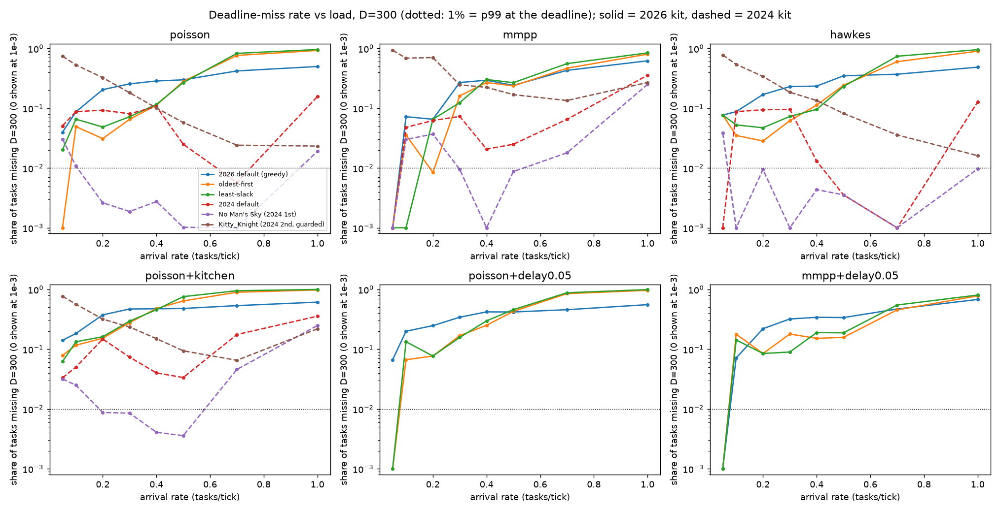

# LoRR-Ext

LoRR-Ext is a testbed that asks **how much of a solver's leaderboard throughput is actually usable once tasks must finish within a deadline**. It extends the [League of Robot Runners](https://www.leagueofrobotrunners.org/) (LoRR) Start-Kit with three things the competition doesn't model:

1. **Known arrival processes (optional).** The default is the competition's always-full task pool. For benchmarking, tasks can instead arrive from a known Poisson, bursty two-state (Markov-modulated Poisson, MMPP) or self-exciting (Hawkes) process.
2. **Uncertain service times, tied to cells.** Work is tied to a place (cutting onions at cell (10, 12)), so each cell has a *known* service-time distribution, as you'd estimate from past data: a uniform interval, or `lognormal`, `gamma`, `exponential`, `normal` or `fixed` with a given mean and coefficient of variation. A robot must stay on its errand cell for a hidden duration drawn from that cell's distribution. Presets: `kitchen` (four work zones) and `stations` (10% of cells are stations); or `all:<dist>`, or your own JSON map.
2b. **Per-cell move delays (2026 kit, off by default).** Each cell has a chance per tick that a robot on it gets stuck, and a distribution for how long. Presets: `kit_like` (the kit's own location-blind model) and `congestion` (narrow passages are risky).
3. **Latency and deadline metrics.** Each task's latency is recorded, along with deadline-miss rates and 99th-percentile latency (tasks still open count as misses), and from these a single gap metric.

The same patch applies to the 2026 Start-Kit (v3.1.0) and to archived 2024-season entries. When the new settings are absent, every kit behaves exactly as released.

> **New here? Start with the illustrated guide [`docs/explainer.md`](docs/explainer.md)**: problem formulation, environment, each algorithm, and every metric, with figures and code pointers.
> How the planners move robots, step by step: [`docs/planning.md`](docs/planning.md).
> Why the solvers differ, in nine small hand-made situations run on the real binaries: [`docs/scenes.md`](docs/scenes.md).
>
> Origin: this repo reproduces, checks and corrects a benchmark first built in a claude.ai research chat. [What changed relative to that chat](#what-the-original-chat-got-right-and-wrong) is listed below.

## Quick start

```bash
bash scripts/setup.sh                       # clone Start-Kit + 2024 entries, patch, build (≈5 min)
uv sync                                     # Python deps (analysis, UI, videos)
uv run pytest -q                            # 20 tests, incl. end-to-end simulations
python3 -m lorrext.bench --out runs/bench   # 616-run grid (≈65 min on 10 cores)
uv run python -m lorrext.analyze --runs runs/bench --out results
uv run python -m lorrext.videos             # side-by-side replay videos
uv run streamlit run lorrext/app.py         # workbench UI
```

Requirements: Linux, CMake, a C++17 compiler, Boost (program_options, system, filesystem), pybind11 headers (for the 2026 kit), ffmpeg, Python ≥ 3.10 and [uv](https://docs.astral.sh/uv/).

## Repository layout

| Path | What it is |
|---|---|
| `ext/lorr_ext.h` | The extension: arrival processes, service-time dwell, per-task records. Header-only, wired in through four hooks. |
| `ext/ext_scheduler.cpp` | Baseline task schedulers for the 2026 kit (oldest-first, least-slack). |
| `tools/patch_kit.py` | Applies the hooks to any kit tree. Whitespace-tolerant, idempotent, and it fails loudly on a missing anchor. Also holds the opt-in Kitty_Knight guards. |
| `scripts/setup.sh` | Fetches pinned sources and builds patched copies into `kits/`. |
| `lorrext/core.py` | Solver registry, instance writer, single-run driver, metrics. |
| `lorrext/bench.py` | Benchmark grid (resumable; each run pinned to 2 dedicated cores). |
| `lorrext/analyze.py` | Capacity, SLA gap, rank correlation, plots → `results/`. |
| `lorrext/replay.py` | Rebuilds runs tick by tick, validates them, renders comparison videos. |
| `lorrext/scenes.py` | Small scripted scenes run on every solver and drawn side by side, plus `hunt` for the worst jam in a big run → `docs/scenes/`. |
| `lorrext/diagnose.py` | Splits each late task's time into unassigned / moving / stuck / dwelling. |
| `lorrext/app.py` | Streamlit workbench (Runs, New sweep, Replay, Compare & diff, Results). |
| `results/` | Committed outputs of the grid: tables, plots, videos. |

## The extension

Turned on by a `lorrExt` object in the instance JSON:

```json
"lorrExt": {
  "arrival":  {"model": "mmpp", "rate": 0.3, "seed": 0,
               "burstFactor": 4.0, "burstFraction": 0.2, "burstLength": 50},
  "mapCols": 32,
  "service":  {"default": null,
               "cells": [{"name": "cut onions", "cells": [[10, 12], [10, 13]],
                          "dist": "lognormal", "mean": 12, "cv": 0.4}],
               "seed": 0, "planQuantile": 0.95},
  "delay":    {"default": {"p": 0.002, "dist": "uniform", "lo": 1, "hi": 2},
               "cells": [{"cells": [[5, 7]], "p": 0.05, "dist": "lognormal", "mean": 4, "cv": 0.6}],
               "seed": 0},
  "deadline": 300,
  "scheduler": "fifo"
}
```

* **Arrivals.** The model is one of `pool` (the original kit), `poisson`, `mmpp` or `hawkes`. All models have the same long-run mean `rate`. A fifth model, `scripted` (`"times": [...]`), reveals task *i* at tick `times[i]` and is used by the scenes. Arrivals come from a dedicated random stream, so every solver sees identical task arrivals for a given seed (this is tested). Task contents still come from the task file, in order.
* **Service.** An errand at cell *v* uses *v*'s distribution (or `default`; `null` = no work). The realised duration is drawn from a generator seeded by (seed, task, errand), so it doesn't depend on solver behaviour. A robot must accumulate that many ticks on the cell. Being pushed off pauses the clock, and the clock restarts if a different robot takes the errand over. Schedulers can read the known distribution through `LorrExt::service_mean_at(v)` and `LorrExt::service_quantile_at(v, q)`; the realised value stays hidden. Maps are built by `lorrext/cellmaps.py`.
* **Delays (2026 kit).** Each tick, a robot on cell *v* that isn't already delayed gets stuck with probability `p` of *v*'s group (or `default`), for a length drawn from that group's distribution. The roll happens again on the tick a delay ends, so a high `p` chains delays; a group with `"trigger": "enter"` rolls only on the tick a robot arrives on the cell (at most one delay per visit). With no `delay` block, travel is deterministic. Delay events are written to `lorrExt.delayEvents`.
* **Records.** The output JSON gets `lorrExt.tasks = [[id, revealed, completed (-1 = open), agent, n_errands], ...]`.
* **Metrics** (see the explainer, §4): throughput; latency mean/p50/p99/max; CVaR95; deadline-miss rate and p99 at several deadlines; normalised latency (stretch); mean open tasks; and, across a sweep, deadline-feasible capacity and the SLA gap.

### Hooks (what `tools/patch_kit.py` changes)

| File | Change |
|---|---|
| `TaskManager.h` | `friend struct LorrExt;` |
| `TaskManager.cpp` | the reveal loop becomes `if (!LorrExt::reveal(...)) while (...)`; the "robot is on its next errand" test becomes `LorrExt::stop_reached(...)` |
| `driver.cpp` | `LorrExt::configure(data, team_size)` after `set_num_tasks_reveal` |
| `CompetitionSystem.cpp` | `LorrExt::save(...)` in `saveResults` |
| `TaskScheduler.cpp` (2026 only) | dispatch to the baseline schedulers |
| `Simulator.cpp` (2026 only) | `LorrExt::simulate_delay(...)` replaces the kit's delay draw when a delay map is set |

## Benchmark setup

* **Instance:** the 2024 main-round RANDOM-01 setup (map `random-32-32-20`, 100 robots, the official task file with 2–5 errands per task), 1000 ticks, first 10% excluded as warm-up.
* **Solvers:**

| Key | Solver | Kit |
|---|---|---|
| `default2026` | 2026 default entry (greedy: each free robot takes its shortest task) | 2026 |
| `fifo2026` | oldest task first, to the nearest free robot | 2026 |
| `slack2026` | least slack first, using the known worst-case service time | 2026 |
| `default2024` | 2024 default entry (archived) | 2024 |
| `nms2024` | No Man's Sky, 2024 1st place, Combined track (commit 44950d1) | 2024 |
| `kitty2024` | Kitty_Knight, 2024 2nd place (commit da7d428), **guarded** (see below) | 2024 |

  The 2024 3rd place entry (SYSU-LCIS) needs the CUDA toolkit and wasn't built.
* **Timing:**
  * 2026 kit: 30 ms ticks with a 300 ms planning window, one tick per move (`agentCounter = 1`). This matches official timing on this instance (175 vs 165 tasks in 400 ticks).
  * 2024 kit: 100 ms planning per tick. No Man's Sky does the same at 1000 ms (210 vs 205 tasks in 200 ticks).
  * Each run is pinned to 2 dedicated cores; No Man's Sky otherwise spawns about 10 threads.
* **Grid:**

| Part | Arrival rates (tasks/tick) | Seeds | Solvers |
|---|---|---|---|
| Pool mode (competition throughput) | — | 3 | all |
| Poisson | 0.05, 0.1, 0.2, 0.3, 0.4, 0.5, 0.7, 1.0 | 3 | all |
| MMPP (bursty) | same | 2 | all |
| Poisson + kitchen service | same | 2 | all |
| Hawkes | same | 1 | all |
| 5% move delay, Poisson and MMPP | same | 1 | 2026 kit only (the 2024 kit has no delay model) |
| Light load, 3000 ticks | 0.05, 0.1, 0.2 | 2 | all |

### Metrics

* **Deadline-feasible capacity** at deadline *D*: the highest tested arrival rate at which at most 1% of tasks miss *D*. That is the same as the 99th-percentile latency being ≤ *D*, counted over tasks that had the full *D* ticks, with open tasks counted as misses.
* **SLA gap** G = 1 − capacity / pool-mode throughput: the share of leaderboard capacity you can't use under the deadline.
* **Low-load failure:** a solver is feasible at some rate but infeasible at a *lower* one.

## Results

> These results come from the first benchmark build: per-errand service intervals (`kitchen` = 2–4 then 10–30 ticks, alternating by errand), the kit's own uniform delays, 1–3 seeds per point, and two since-removed staging baselines (now dropped from the tables). Service and delays are now per cell, so rerun the grid before quoting numbers.

The full tables are in [`results/summary.md`](results/summary.md) (deadlines 200, 300 and 400 ticks) and the per-run data is in `results/runs.csv`.

### Capacity and SLA gap at a 300-tick deadline

| Solver | Kit | Pool throughput | Capacity: Poisson | MMPP | Hawkes | Kitchen | G: Poisson | MMPP | Kitchen |
|---|---|---|---|---|---|---|---|---|---|
| Kitty_Knight (guarded) | 2024 | **1.11** | 0 | 0 | 0 | 0 | 1.00 | 1.00 | 1.00 |
| No Man's Sky | 2024 | 1.06 | 0.7 | 0.5 | 1.0 | 0.5 | 0.34 | 0.53 | 0.53 |
| 2024 default | 2024 | 0.81 | 0.7* | 0.05 | 0.7* | 0 | 0.14* | 0.94 | 1.00 |
| 2026 default (greedy) | 2026 | 0.44 | 0 | 0.05 | 0 | 0 | 1.00 | 0.89 | 1.00 |
| oldest-first | 2026 | 0.40 | 0.05 | 0.2 | 0 | 0 | 0.88 | 0.50 | 1.00 |
| least-slack | 2026 | 0.40 | 0 | 0.1 | 0 | 0 | 1.00 | 0.75 | 1.00 |

Capacity and throughput are in tasks/tick. \* = feasible at that rate but infeasible at every lower rate tested (a low-load failure).



### Findings

1. **The leaderboard metric doesn't predict usable capacity.**
   * Kitty_Knight has the highest pool throughput on this instance, but no tested arrival rate gets its misses under 1%.
   * Across the 8 solvers, the Spearman rank correlation between pool throughput and deadline capacity ranges from −0.29 to +0.51 depending on scenario and deadline. None is significant (p ≥ 0.19, n = 8).
2. **Several solvers get *worse* as load drops.** Miss rates for Kitty_Knight and the 2024 default fall as the arrival rate rises (the U-shaped curves above). With a 3000-tick horizon at 0.05 tasks/tick, only about 147 tasks arrive in a run. Of those, these are still open at the end:

   | Solver | Tasks still open |
   |---|---|
   | Kitty_Knight | 26 |
   | 2024 default | 19 |
   | 2026 default | 17 |
   | oldest-first, least-slack | 7.5–8 |
   | No Man's Sky | 6 |

   No setting gets under the 1% criterion at 0.05–0.1 tasks/tick over that horizon. Pool mode never has idle robots, so the competition can't observe this.
3. **The mechanism is idle robots blocking busy ones, not starvation.** `lorrext.diagnose` splits each late task's time:

   | Run | Unassigned | Assigned robot stuck | Stuck time with an idle robot adjacent |
   |---|---|---|---|
   | Kitty_Knight @ 0.05 | 0.1% | 90% | 89% |
   | 2024 default @ 0.1 | 0% | 90% | 82% |
   | 2026 default @ 0.3 | 4% | 57% | 20% |
   | No Man's Sky @ 0.05 / 0.1 / 0.7 | — | 1 late task each | — |

   The 2026 default fails differently: its late tasks are congested among *busy* robots. In the 2026 default planner, an idle robot's placeholder goal is its initial start cell (`default_planner/planner.cpp`), so idle robots drive back there and park.
4. **Burstiness and service times cost capacity even for the winner.** No Man's Sky's usable share falls from 66% (Poisson) to 47% (bursty) and 47% (kitchen service times).
5. **Service times behave as specified.** At light load, kitchen service raises median latency by 25–37 ticks against an expected dwell of about 36 ticks. Replays confirm every errand is held for at least the lower bound of its interval.
6. **The 5% move-delay model costs every 2026-kit scheduler.** It adds 5–64 ticks to median latency, growing with load for oldest-first and least-slack.
7. **The kit matters as much as the solver.** The same greedy scheduler gets 0.81 tasks/tick in the 2024 kit and 0.44 in the 2026 kit. In the 2026 kit, busy robots wait on 50% of ticks, against 10% for No Man's Sky. That holds under official timing too, so compare solvers within a kit.

### Videos

The videos in `results/videos/` (900 ticks each, identical arrivals on both sides) were made with `python -m lorrext.videos`, and every replay passes `lorrext.replay validate` (no two robots on one cell, every errand event on the robot's cell).

| Video | Shows |
|---|---|
| `1_greedy_vs_oldest_first` | 2026 default vs oldest-first at 0.3 tasks/tick: p99 430 vs 342 ticks |
| `2_winner_vs_runnerup` | No Man's Sky vs Kitty_Knight at 0.7: same throughput (0.62 vs 0.60), p99 210 vs 344 |
| `3_lowload_winner_vs_runnerup` | the same pair at 0.05: Kitty_Knight's tasks pile up behind idle robots (p99 889 vs 379) |
| `4_lowload_2024_default_vs_winner` | 2024 default vs No Man's Sky at 0.1 (p99 619 vs 233) |
| `5_kitchen_service_times` | 2026 default vs oldest-first with kitchen service at 0.2 (p99 589 vs 358) |

## What the original chat got right and wrong

This repo re-implements the benchmark from the chat, since the chat's zip files weren't available. Every claim below was re-checked.

| Claim in the chat | Status here |
|---|---|
| Scaled timing (30 ms/tick, 300 ms window) keeps solver quality | ✅ 175 vs 165 tasks in 400 ticks |
| Winners' changes to kit system files are formatting-only | ⚠️ True for `TaskManager`/`CompetitionSystem`. No Man's Sky's `driver.cpp` has functional additions (graph-guidance settings), which don't touch the task flow. |
| Kitty_Knight crashes when free robots outnumber tasks | ✅ `exit(-1)` in its scheduler. It *also* aborts in its LNS (Large Neighbourhood Search) planner when service times keep a robot short of its goal, so this repo needs two guards (both labelled). |
| The 2024 default works with random arrivals | ✅ But a naive patch breaks it: the 2024 kit clears `new_tasks` inside `reveal_tasks`, and skipping that line makes the entry re-assign finished tasks. This repo's first patch had exactly that bug (fixed). |
| 2026 Start-Kit writes the first snapshot into every path segment | ✅ `Simulator.cpp` uses `chunked_actual_snapshot_states[i][0]`. Also found: the first schedule entry carries an uninitialised timestep. |
| Greedy fails because far tasks starve | ❌ (the chat later retracted this) Late tasks are assigned more than 93% of the time. |
| Correction: idle robots that never move block busy ones | ✅ For Kitty_Knight and the 2024 default (82–89% of stuck time next to an idle robot). ❌ For the 2026 default, whose late tasks are congested among busy robots. |
| 2026 default's p99 gets worse as load drops (443 vs 212 ticks) | ❌ Not reproduced: its miss rate rises steadily with load. The low-load pathology is real, but it belongs to other solvers. |
| Rank correlation throughput ↔ capacity = −0.22 | ⚠️ Here −0.29 to +0.51, never significant. The conclusion (throughput rank says little) holds; the number doesn't. |
| No Man's Sky keeps all capacity under Poisson, loses 36% bursty, 50% kitchen | ⚠️ Here it loses 34% / 53% / 53%. The direction holds. Part of the Poisson loss is grid resolution (0.7 → 1.0). |
| Kitty_Knight misses the deadline at every load | ✅ |
| Throughput comparisons across kits (0.93 vs 2.43 tasks/tick) | ⚠️ Mixes kit effects. The 2026 kit halves the same greedy scheduler's throughput, so compare within a kit. |

## Caveats

* One map and 100 robots, on 2 cores per run, with 3× (2026 kit) and 10× (2024 kit) less planning time than the competition. No Man's Sky loses nothing from that reduction on this instance; other entries weren't checked.
* Seeds: Poisson 3, MMPP and kitchen 2, Hawkes and delay 1. Light-load results at 1000 ticks rest on about 30 scored tasks per run; the 3000-tick runs confirm them.
* The capacity grid is coarse (… 0.5, 0.7, 1.0).
* Kitty_Knight runs with two guards that change its code. SYSU-LCIS (2024 3rd) wasn't built (it needs CUDA). 2026-season entries aren't archived yet.
* The 2026 kit runs in real time: heavy background CPU load lowers its results. The benchmark pins runs to dedicated cores for this reason.
* Open: in the 2026 kit about half the robots are waiting at any moment, in streaks of 10–39 ticks, even in two-robot scenes ([scenes](docs/scenes.md#what-the-scenes-say)). Whether that is the default planner itself or our real-time settings starving it is not yet settled, and it affects every 2026-kit number above.

## UI

`uv run streamlit run lorrext/app.py` opens a workbench with five tabs, following the UX plan from the chat:

* **Runs:** filter past runs and select two to compare.
* **New sweep:** set the arrival model with a preview of sampled arrivals and burst statistics, service intervals, delay, seeds, rates and methods. It shows the run count and time estimate, warns when kits are mixed, then launches.
* **Replay:** tick slider, map, "jump to worst task", the selected task's step-by-step history, and a strip of deadline misses.
* **Compare & diff:** metric deltas, the settings that differ, a task-by-task latency diff (same arrivals for the same seed), lockstep maps and MP4 export.
* **Results:** latency or miss rate vs load for any scenario, a capacity/gap table with a deadline slider, and a leaderboard-rank vs capacity-rank chart.

## License

MIT for this repository. The League of Robot Runners Start-Kit and the archived entries are MIT-licensed by their authors; `scripts/setup.sh` downloads them rather than vendoring them.
