# How LoRR-Ext works: problem, environment, algorithms, metrics

This is a guided tour for someone new to the code. Each section goes **intuition → a little math → the code**. Figures are generated by [`docs/make_figures.py`](make_figures.py) from real runs, so the numbers in them are real.

Code links point to:
* this repository (`ext/`, `lorrext/`, `tools/`);
* the official Start-Kit at tag [v3.1.0](https://github.com/MAPF-Competition/Start-Kit/tree/v3.1.0) (the 2026 kit);
* the [Code-Archive](https://github.com/MAPF-Competition/Code-Archive) (2024 entries).

`scripts/setup.sh` places local copies under `third_party/` and `kits/`.

Contents
1. [The problem in one picture](#1-the-problem-in-one-picture)
2. [The environment](#2-the-environment)
3. [The algorithms](#3-the-algorithms)
4. [The metrics](#4-the-metrics)
5. [Running it](#5-running-it)
6. [Glossary](#6-glossary)

### Notation used throughout

| Symbol | Meaning |
|---|---|
| $t$, $T$ | a tick (one simulation step) and the run length in ticks (1000 here) |
| $m$ | number of robots (100) |
| $v$, $u$ | grid cells |
| $d(u, v)$ | **grid distance**: fewest moves from cell $u$ to cell $v$ around obstacles, ignoring turns (a breadth-first search on the map) |
| $j$ | a task; $e_{j,1}, \dots, e_{j,k_j}$ are its $k_j$ errand cells, in order |
| $r_j$, $c_j$ | the tick task $j$ appears (is revealed) and the tick its last errand is done |
| $L_j = c_j - r_j$ | **latency** of task $j$ |
| $\mathcal{S}_v$ | the known **service-time distribution** at cell $v$ (how long work takes there) |
| $s_{j,\ell}$ | the actual (hidden) service time of errand $\ell$ of task $j$, drawn from $\mathcal{S}_{e_{j,\ell}}$ |
| $p_v$, $\mathcal{B}_v$ | per-cell **delay**: chance per tick that a robot on $v$ gets stuck, and the distribution of how long |
| $q_\alpha(X)$ | the **$\alpha$-quantile** of a random quantity $X$: the value $X$ stays below with probability $\alpha$ (e.g. $q_{0.95}$ = 95th percentile) |
| $\mathbb{E}[X]$ | the mean (expected value) of $X$ |
| $D$, $\varepsilon$ | a deadline in ticks (300 here) and an allowed miss rate (1%) |
| $\lambda$ | arrival rate: average number of new tasks per tick (only with arrival processes) |

---

## 1. The problem in one picture

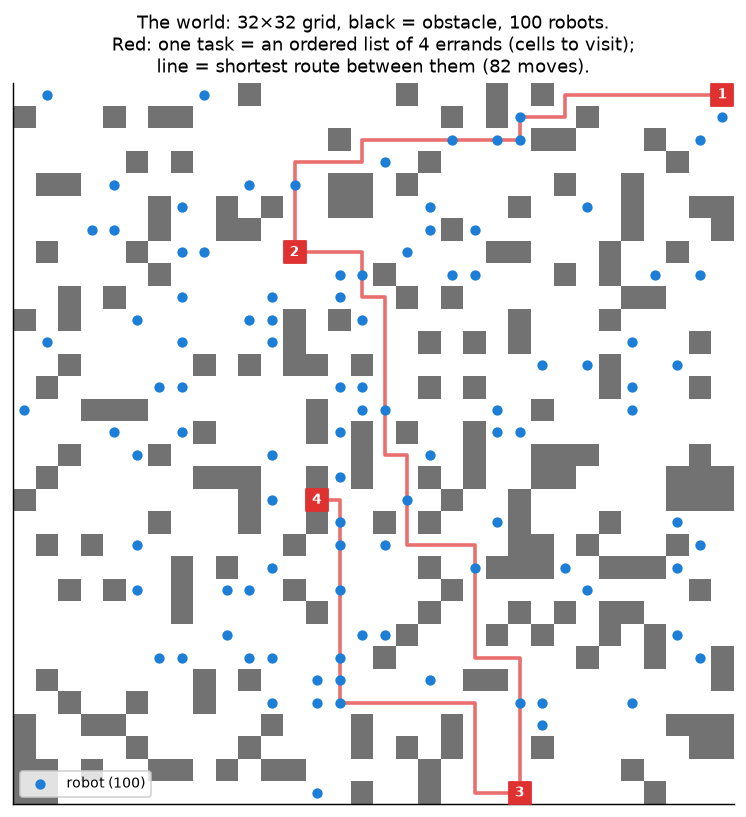

**Intuition.** A warehouse, kitchen or factory floor is a grid. 100 robots drive around, and jobs keep coming in. Each job, called a **task**, is a short list of cells the robot must visit in order and *work at*: pick ingredients here, cut onions there, hand over the dish there. Two decisions are made over and over:

1. **Assignment:** which robot should do which task?
2. **Path planning:** which way should every robot move *this tick* so that nobody collides?

The competition this is built on, the [League of Robot Runners](https://www.leagueofrobotrunners.org/) (LoRR), scores you on **how many tasks you finish** in a fixed time. Our question is different: **can every task finish within a deadline, even when work and travel times are uncertain?**

**A little math.** Each tick $t$ the system chooses:

* an **assignment**: for each robot, one open task or none;
* one **action** per robot from $\{F, R, C, W\}$ (forward, turn right, turn left, wait), such that no two robots end in the same cell or swap cells.

The objectives being compared:

$$\textbf{Competition: } \max\; \frac{\#\{\text{tasks with } c_j \le T\}}{T} \qquad\text{(throughput, tasks per tick)}$$

$$\textbf{LoRR-Ext: } \text{keep } \Pr[L_j > D] \le \varepsilon \text{ (at most 1\% of tasks later than } D = 300 \text{ ticks), and ask: up to what load can a solver keep that promise?}$$

**What the solver knows and doesn't know:**

| | Known in advance | Revealed online | Never revealed |
|---|---|---|---|
| Map, robot start cells | ✓ | | |
| Tasks | the *process* they come from (pool, or an arrival-rate model) | each task when it appears | |
| Travel | 1 tick per move or turn; the per-cell delay map $p_v, \mathcal{B}_v$ if delays are on | | when and for how long a robot actually gets stuck |
| Work at a cell (service) | the per-cell distribution $\mathcal{S}_v$ | | the actual duration $s_{j,\ell}$: the robot just has to wait until it's done |

This is a *lifelong, online* version of the problem known as **multi-agent pickup and delivery (MAPD)**. "Lifelong" means it never ends, and "online" means tasks are only known once they appear.

---

## 2. The environment

### 2.1 The simulation loop

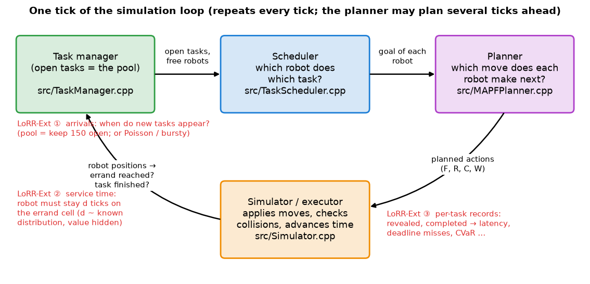

Every tick:
1. The **task manager** keeps the set of open tasks (the *pool*). It checks whether any robot has finished its current errand, and reveals new tasks.
2. The **scheduler** proposes, for each robot, a task id (or −1 for none).
3. The **planner** turns each robot's current goal (its task's next errand cell) into actions.
4. The **simulator** applies the actions, rejects collisions, applies delays, and advances time.

Code (2026 kit):
* the loop: [`BaseSystem::simulate`](https://github.com/MAPF-Competition/Start-Kit/blob/v3.1.0/src/CompetitionSystem.cpp#L117);
* scheduler then goals then planner: [`Entry::compute`](https://github.com/MAPF-Competition/Start-Kit/blob/v3.1.0/src/Entry.cpp#L21);
* goal = next errand: [`update_goal_locations`](https://github.com/MAPF-Competition/Start-Kit/blob/v3.1.0/src/Entry.cpp#L35);
* errand reached / task done: [`check_finished_tasks`](https://github.com/MAPF-Competition/Start-Kit/blob/v3.1.0/src/TaskManager.cpp#L131);
* reveal: [`reveal_tasks`](https://github.com/MAPF-Competition/Start-Kit/blob/v3.1.0/src/TaskManager.cpp#L187).

### 2.2 Robots and moves

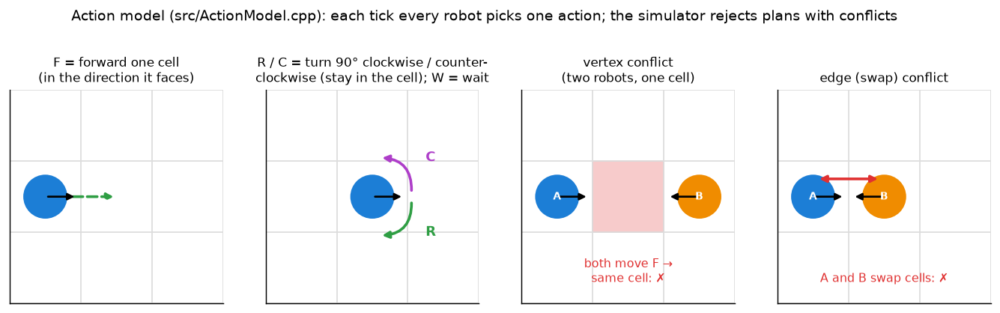

A robot has a cell **and a heading**. `F` moves one cell in the heading direction, `R`/`C` rotate 90° on the spot, and `W` waits. Turning costs a tick, so a robot facing the wrong way needs 1–2 extra ticks before it can move. This matters for how quickly a robot can get out of someone's way (§3.4) and why travel takes longer than $d(u, v)$ (§3.7).

Code: move deltas east/south/west/north are [`moves[0..3]`](https://github.com/MAPF-Competition/Start-Kit/blob/v3.1.0/inc/ActionModel.h#L16), and the forward step is [`ActionModel.cpp#L476`](https://github.com/MAPF-Competition/Start-Kit/blob/v3.1.0/src/ActionModel.cpp#L476).

### 2.3 Time: two kits, two clocks

| | 2024 kit (No Man's Sky, Kitty_Knight, 2024 default) | 2026 kit (2026 default + our baselines) |
|---|---|---|
| How time passes | the simulator **waits** for the planner each tick (up to a budget; we use 100 ms) | **real time**: a tick every 30 ms whether or not the planner is done; the planner sends a multi-step plan every 300 ms |
| A move takes | 1 tick | `agentCounter` ticks (we set 1 so both kits agree) |
| Random move delays | no | yes (§2.7); off by default |

Because of this, the same greedy idea gets 0.81 tasks/tick in the 2024 kit and 0.44 in the 2026 kit. **Compare solvers within a kit.**

### 2.4 Where tasks come from: the pool (default)

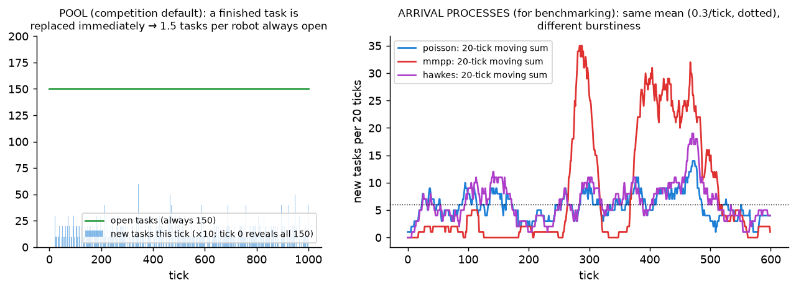

**Pool mode** is the competition's setting and our default. The kit keeps exactly `numTasksReveal` × $m$ = 1.5 × 100 = **150 tasks open** at all times. The moment one finishes, the next task from the task file appears. Two consequences:

* There is always more work than robots (150 tasks for 100 robots), so robots are rarely idle, and at least 50 tasks are always waiting.
* A task's latency includes the time it waits in the pool before any robot takes it. So in pool mode latency measures **the order in which the pool is served**, not just driving time.

**Arrival processes** are optional, for benchmarking. Tasks then appear at random times with a known mean rate $\lambda$:
* Poisson: steady;
* MMPP (Markov-modulated Poisson): calm periods and bursts at 4× the rate;
* Hawkes: each task makes more tasks likely soon after.

Sweeping $\lambda$ is how we find the highest load a solver can handle under a deadline (§4.6). Code: [`LorrExt::draw_arrivals`](../ext/lorr_ext.h#L372) and [`LorrExt::reveal`](../ext/lorr_ext.h#L412). Select a process with `Setting(arrival="poisson", rate=0.3)`.

### 2.5 The life of one task

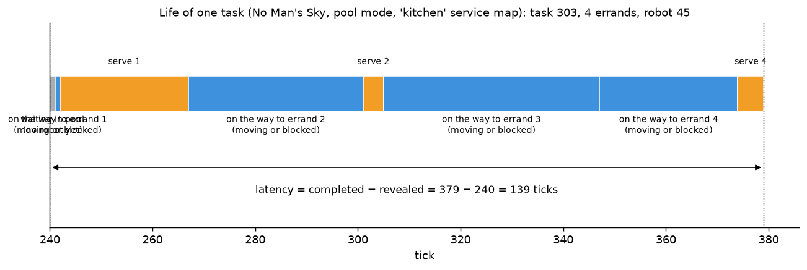

A real task from a No Man's Sky run (pool mode, `kitchen` service map). Grey: waiting in the pool. Blue: on the way to the next errand (moving *or* blocked by other robots). Orange: working on the errand cell. Latency $L_j$ is the whole bar.

### 2.6 Service times belong to cells

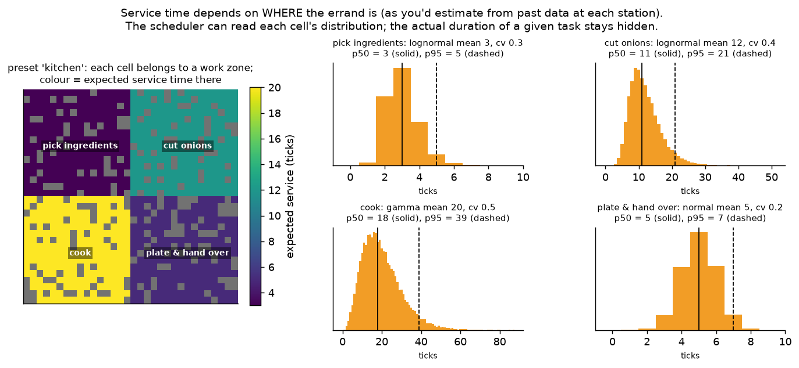

**Intuition.** In a factory or a chain-store kitchen the work is tied to a *place*: onions are cut at the cutting station, food is cooked at the stove. From past data you know how long each station usually takes, and how much it varies. So each cell $v$ carries its own distribution $\mathcal{S}_v$. A robot whose errand is at $v$ must stay on $v$ until the (hidden) work is done.

**Rule.** For errand $\ell$ of task $j$, at cell $v = e_{j,\ell}$:

$$s_{j,\ell} \sim \mathcal{S}_{v}, \qquad \text{rounded to whole ticks, clamped to the cell's } [\min, \max].$$

The robot accumulates ticks on the cell; being pushed off pauses the clock. Cells with no entry need no work. Every solver sees the *same* draw for the same errand, because the draw is seeded from (seed, task, errand), not from solver behaviour.

**Distribution families** ($\mu$ = mean, cv = coefficient of variation = standard deviation ÷ mean, a unit-free measure of spread):

| Spec | Shape |
|---|---|
| `10-30` | uniform integer interval (the "interval" setting) |
| `fixed:20` | always 20 |
| `normal:20:0.3` | bell curve, cut off at the minimum |
| `gamma:20:0.5`, `lognormal:20:0.5` | right-skewed: usually near the mean, occasionally much longer |
| `exponential:20` | memoryless, cv = 1, the heaviest tail of these |
| `gamma:20:0.5:1:120` | the same family plus bounds [1, 120] |

**Where maps come from** (`Setting.service`, or the UI's *service map* picker; implemented in [`lorrext/cellmaps.py`](../lorrext/cellmaps.py)):
* `none`: no work anywhere (the original competition).
* `kitchen`: four zones, shown above. Every cell belongs to *pick ingredients*, *cut onions*, *cook* or *plate & hand over*.
* `stations`: 10% of cells are stations (cut / cook / wash); elsewhere work is instant.
* `all:lognormal:20:0.5`: the same distribution on every cell.
* `path/to/site.json`: your own map, e.g. estimated from real data:

```json
{"default": null,
 "cells": [{"name": "cut onions", "cells": [[10, 12], [10, 13]], "dist": "lognormal", "mean": 12, "cv": 0.4},
           {"name": "stove",      "cells": [[20, 5]],             "dist": "gamma",     "mean": 30, "cv": 0.5}]}
```

**What a scheduler may read:** `LorrExt::service_mean_at(v)` and `LorrExt::service_quantile_at(v, α)`, i.e. $\mathbb{E}[\mathcal{S}_v]$ and $q_\alpha(\mathcal{S}_v)$. Never $s_{j,\ell}$.

Code: [`ServiceDist`](../ext/lorr_ext.h#L44) (`draw` at [L76](../ext/lorr_ext.h#L76)), [`service_dist_at`](../ext/lorr_ext.h#L288), [`service_time`](../ext/lorr_ext.h#L312), and the dwell check [`stop_reached`](../ext/lorr_ext.h#L440).

**Checked** (`tests/test_lorrext.py::test_service_map_end_to_end`): dwell times observed in replays match each zone's distribution. For example, *cook* has q05/q50/q95 of 7/18/39 configured and 7/18/41 observed.

### 2.7 Move delays belong to cells too (2026 kit)

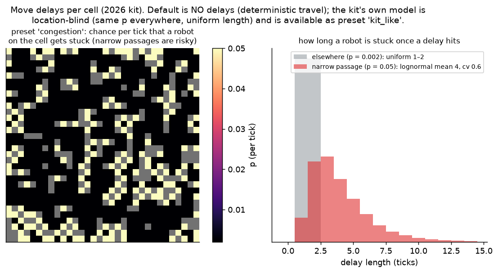

**What the 2026 kit already has.** Each tick, every robot that isn't already delayed gets stuck with the *same* probability `pDelay` everywhere. The delay length is uniform in `[minDelay, maxDelay]` (a clamped bell curve is also available). It is location-blind. Code: [`DelayGenerator.cpp`](https://github.com/MAPF-Competition/Start-Kit/blob/v3.1.0/src/DelayGenerator.cpp).

**What LoRR-Ext adds.** The same idea as service times: each cell $v$ has a delay chance $p_v$ and a delay-length distribution $\mathcal{B}_v$. Each tick, a robot on $v$ that isn't already delayed gets stuck with probability $p_v$, for a length drawn from $\mathcal{B}_v$, and cannot move until the delay ends.

**Default: no delays** (deterministic travel). Presets (`Setting.delay`):
* `kit_like`: the kit's own model ($p = 0.01$ everywhere, uniform 1–4 ticks);
* `congestion`: narrow cells, i.e. cells with at most 2 free neighbours, have $p = 0.05$ with a lognormal length of mean 4; elsewhere $p = 0.002$;
* `all:0.02:gamma:3:0.5` ($p$ first, then the distribution);
* a `.json` file in the same format as service maps, with a `"p"` per group.

The 2024 kits have no delay mechanism, so they reject delay maps.

Code: [`simulate_delay`](../ext/lorr_ext.h#L342), hooked into the kit's `Simulator::simulate_delay`.

**Checked** (`test_delay_map_end_to_end`):
* with `all:0.02:gamma:3:0.5`: 0.0194 delays per robot-tick and a mean length of 3.03 ticks, against 0.02 and 3 configured;
* with `congestion`: 82% of delays happen on narrow cells, which make up 22% of the map;
* a delayed robot never moves during its delay.

### 2.8 What LoRR-Ext changes in the kit

A handful of small hooks, applied by [`tools/patch_kit.py`](../tools/patch_kit.py):
1. the reveal loop calls `LorrExt::reveal` (arrival processes; does nothing in pool mode);
2. the "robot is on its errand" test calls `LorrExt::stop_reached` (service time);
3. the simulator's delay step calls `LorrExt::simulate_delay` (2026 kit; does nothing without a delay map);
4. the driver reads the `lorrExt` block from the instance JSON;
5. the results writer adds per-task records `[id, revealed, completed, robot, #errands]` and the delay events.

With no `lorrExt` block, the kit behaves exactly as released.

---

## 3. The algorithms

Every solver has the same two layers: a **scheduler** (assignment) and a **planner** (moves).

| Solver | Kit | Scheduler | Planner |
|---|---|---|---|
| 2026 default | 2026 | greedy: each free robot takes its nearest task | traffic-flow-guided PIBT |
| 2024 default | 2024 | greedy (same idea) | traffic-flow-guided PIBT |
| oldest-first (`fifo2026`) | 2026 | oldest task gets the nearest free robot | 2026 default planner |
| least-slack (`slack2026`) | 2026 | most urgent task first (deadline, path, $q_{0.95}$ of service) | 2026 default planner |
| No Man's Sky (2024 1st) | 2024 | simulated-annealing assignment, may switch unstarted tasks | 32 randomized PIBT runs in parallel, keep the best, plus guidance |
| Kitty_Knight (2024 2nd) | 2024 | global greedy matching (closest robot-task pair first) | windowed large-neighbourhood search (WPPL) |

### 3.1 Schedulers at a glance

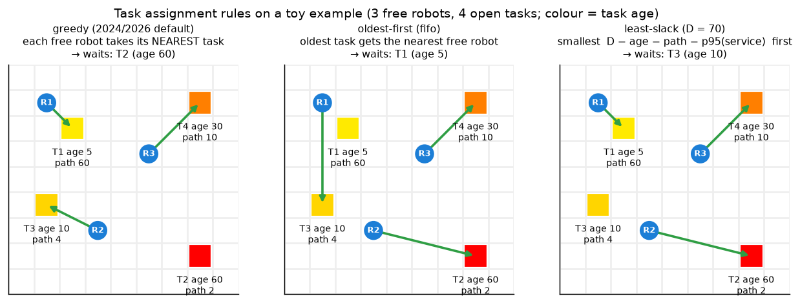

Same situation, three rules, three different tasks left waiting. "path" is the task's own length, i.e. the grid distance from its first errand through to its last.

* **Greedy** (both defaults). Each free robot, in turn, takes the open task with the smallest *robot → first errand → … → last errand* distance:

  $$\text{task for robot } i = \arg\min_{j \text{ open, unassigned}} \Big[ d(v_i, e_{j,1}) + \sum_{\ell=1}^{k_j-1} d(e_{j,\ell}, e_{j,\ell+1}) \Big]$$

  Here $v_i$ is robot $i$'s current cell. It is good for throughput because there's little empty driving. It is bad for fairness: a task that is far from everyone is never anyone's best choice, so in pool mode it can wait a very long time. The 2026 default's p99 in pool mode is 798 ticks, against 514 for oldest-first. Code: [`schedule_plan`](https://github.com/MAPF-Competition/Start-Kit/blob/v3.1.0/default_planner/scheduler.cpp#L23).
* **Oldest-first** (`fifo`). Sort open tasks by reveal time $r_j$, and give each the free robot with the smallest $d(v_i, e_{j,1})$. No task waits forever. Code: [`LorrExtSched::plan`](../ext/ext_scheduler.cpp#L48).
* **Least-slack** (`slack`). Serve first the task with the least spare time:

  $$\text{slack}_j = D \;-\; \underbrace{(t - r_j)}_{\text{age}} \;-\; \underbrace{\sum_{\ell=1}^{k_j-1} d(e_{j,\ell}, e_{j,\ell+1})}_{\text{path}} \;-\; \underbrace{\sum_{\ell=1}^{k_j} q_{0.95}\big(\mathcal{S}_{e_{j,\ell}}\big)}_{\text{service, budgeted at its 95th percentile}}$$

  This is the scheduler that uses the known per-cell distributions: it plans with a time that work at each cell will finish within 95% of the time. Code: [`ext_scheduler.cpp#L80`](../ext/ext_scheduler.cpp#L80) and [`safe_service`](../ext/ext_scheduler.cpp#L39).
* **No Man's Sky.** A local search with simulated annealing over the whole assignment. Its cost per robot $i$ and task $j$ is about $5 \cdot d(v_i, e_{j,1}) + \text{path}_j$, so it penalises empty driving 5× ([`scheduler_solver.cpp#L63`](https://github.com/MAPF-Competition/Code-Archive/blob/main/2024%20Competition/Team_No_Man's_Sky/44950d1b61b7482b4529a9dc127fa9d220962bdc/Solution/Scheduler/scheduler_solver.cpp#L63)). It re-optimises every tick and switches unstarted tasks between robots (§3.5).
* **Kitty_Knight.** Global greedy matching: among all (free robot, free task) pairs, repeatedly pick the closest pair ([`greedy_matching2`](https://github.com/MAPF-Competition/Code-Archive/blob/main/2024%20Competition/Team_Kitty_Knight/da7d428b40cc1425b381adefe9709d4accbfdfe1/wppl_planner/src/scheduler.cpp#L368)). It assumes there are always more tasks than robots and calls `exit(-1)` otherwise; this repo adds a labelled guard.

### 3.2 Planners: PIBT, the common core

> For a deeper, illustrated walk through every planner (PIBT, traffic guidance, the 2026 executor, No Man's Sky, WPPL, SIPP, LNS, LaCAM), see [`planning.md`](planning.md).


**PIBT (Priority Inheritance with Backtracking)**, one tick:
1. Sort robots by priority. In the default planner, a robot's priority grows by 1 each planning round while it keeps the same goal, resets when it gets a new goal, and gets +10 in a dead end ([`planner.cpp#L153-L161`](https://github.com/MAPF-Competition/Start-Kit/blob/v3.1.0/default_planner/planner.cpp#L153-L161)). A robot that has been trying to reach its goal for a long time therefore wins conflicts, while idle robots keep the lowest priority.
2. The highest-priority robot picks its best neighbouring cell, the one with the smallest distance to its goal.
3. If another robot sits there, that robot **inherits** the priority and must move first: recursively, pick *its* best free cell.
4. If it can't move anywhere, the request fails and the first robot **backtracks** and tries its next-best cell.

Code: [`causalPIBT`](https://github.com/MAPF-Competition/Start-Kit/blob/v3.1.0/default_planner/pibt.cpp#L44) and the per-tick loop [`run_multistep_pibt_once`](https://github.com/MAPF-Competition/Start-Kit/blob/v3.1.0/default_planner/planner.cpp#L225).

On top of PIBT:
* **Traffic-flow guidance** (both defaults). Before PIBT, compute a *guide path* for every robot that spreads traffic over the map (a Frank-Wolfe optimisation over edge congestion, [`frank_wolfe`](https://github.com/MAPF-Competition/Start-Kit/blob/v3.1.0/default_planner/flow.cpp#L94)). PIBT then measures "closer to the goal" along that guide path. Reference: Chen et al., *Traffic Flow Optimisation for Lifelong MAPF*, AAAI 2024.
* **No Man's Sky.** It runs **32 randomized PIBT variants in parallel** ([`THREADS = 32`](https://github.com/MAPF-Competition/Code-Archive/blob/main/2024%20Competition/Team_No_Man's_Sky/44950d1b61b7482b4529a9dc127fa9d220962bdc/Solution/settings.hpp#L57), [`eplanner.cpp#L36`](https://github.com/MAPF-Competition/Code-Archive/blob/main/2024%20Competition/Team_No_Man's_Sky/44950d1b61b7482b4529a9dc127fa9d220962bdc/Solution/Planner/eplanner.cpp#L36)), scores each, keeps the best, and improves each robot's preferred direction by annealing. This is why it uses about 10 cores if you let it; the benchmark pins every run to 2.
* **Kitty_Knight (WPPL).** It plans a 20-tick **window** for everyone (initial solution from LaCAM2, a fast PIBT-style search). It then repeatedly destroys and re-plans small groups of robots (8 at a time) with prioritized planning plus SIPP (safe-interval path planning), keeping changes that shorten paths. This is large neighbourhood search (LNS). Config: [`random-32-32-20.json`](https://github.com/MAPF-Competition/Code-Archive/blob/main/2024%20Competition/Team_Kitty_Knight/da7d428b40cc1425b381adefe9709d4accbfdfe1/wppl_planner/configs/random-32-32-20.json).

### 3.3 What idle robots do

This detail turns out to matter most:

* **2026 default.** A robot with no task gets a *placeholder goal: its initial start cell* ([`planner.cpp#L99`](https://github.com/MAPF-Competition/Start-Kit/blob/v3.1.0/default_planner/planner.cpp#L99)). Idle robots drive back there and park, with the lowest priority.
* **Others.** Each entry handles idle robots in its own way.

### 3.4 How each one fails (observed)

From `python -m lorrext.diagnose` on replays (each late task's time split into waiting for a robot, moving, stuck, and working):

* **Kitty_Knight and the 2024 default, at light load.** 90% of a late task's time is spent with its robot **stuck**, and 82–89% of that with an **idle robot right next to it**. Idle robots don't make room (turning costs ticks, and some planners never push them), so busy robots get boxed in. Some tasks never finish. In pool mode there are never idle robots, so the competition can't see this.
* **2026 default.** Its late tasks are stuck among *busy* robots: congestion.
* **No Man's Sky.** At most one late task per run at light and moderate load.

### 3.5 Can a task be switched to another robot after it's assigned?

**Yes, until the robot reaches the task's first errand.** The kit calls a task *opened* once its first errand is done. From then on it's locked to that robot, and the robot can't be given anything else. Before that, the scheduler may move it to any robot, every tick. Code: the two checks in [`validate_task_assignment`](https://github.com/MAPF-Competition/Start-Kit/blob/v3.1.0/src/TaskManager.cpp#L46-L58).

Who uses it:

| Solver | Tasks that changed robot at least once | Most robots one task had |
|---|---|---|
| 2026 default, oldest-first, least-slack | 0% (they never switch) | 1 |
| No Man's Sky, pool mode | 45% | 18 |
| No Man's Sky, Poisson λ = 0.7 | 27% | 10 |
| Kitty_Knight, Poisson λ = 0.7 | 33% | 29 |

Switching lets a solver fix a bad match when a closer robot frees up, or when the chosen robot gets stuck (§3.7). Too much switching wastes driving: a task bounced between 29 robots got many half-trips.

### 3.6 Can we change the planner?

**Yes.** The planner is a separate component ([`MAPFPlanner::plan`](https://github.com/MAPF-Competition/Start-Kit/blob/v3.1.0/src/MAPFPlanner.cpp#L32)). The competition even runs separate tracks for scheduling only, planning only, and both. Today our baselines only change the scheduler and reuse the 2026 default planner. No Man's Sky and Kitty_Knight replace both layers.

Swapping in another planner means implementing that one function: given every robot's position, heading and goal, return the next actions. Good candidates are Keisuke Okumura's planners ([github.com/Kei18](https://github.com/Kei18)): PIBT, LaCAM and LaCAM*, which most entries already borrow from. Wiring them in is planned as a later step.

### 3.7 Travel takes longer than the map distance. Can we predict by how much?

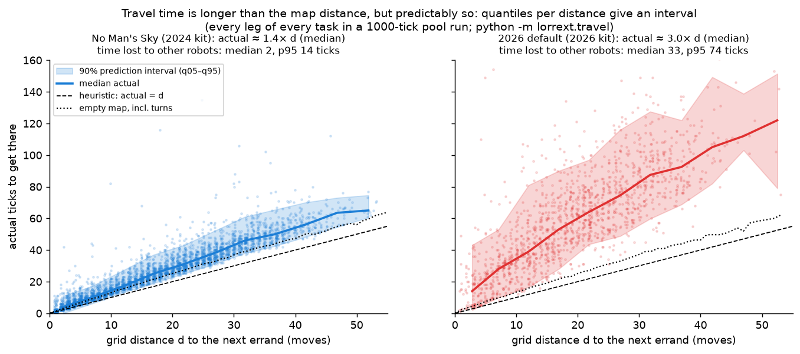

**Intuition.** Schedulers estimate driving time with the grid distance $d(u, v)$. Real driving takes longer for two reasons:
1. **turns**: each 90° turn costs a tick (the dotted line, "empty map, incl. turns", is the exact time with no other robots);
2. **other robots**: waiting, detours, being pushed.

Reason 1 is small and exactly computable. Reason 2 depends on the planner and on traffic.

**Measured** with `python -m lorrext.travel` on every leg (from getting the task, or finishing an errand, to arriving at the next errand) of a 1000-tick pool run:

| | Median actual ÷ $d$ | Time lost to other robots (median / 95th pct) | Prediction interval for a 20–29-cell trip |
|---|---|---|---|
| No Man's Sky | 1.4× | 2 / 14 ticks | 26–48 ticks |
| 2026 default | 3.0× | 33 / 74 ticks | 45–108 ticks |

So **yes, the range is predictable**. For each distance, the 5th and 95th percentiles of past legs give a 90% **prediction interval** (the shaded band). The interval depends on the planner (narrow for No Man's Sky, wide in the 2026 kit) and would also depend on load and delays. Code: [`travel.legs`](../lorrext/travel.py#L58) and [`interval_table`](../lorrext/travel.py#L94).

**Should the assignment change when a path turns out longer than $d$?** Two cases:
* **Fairness between candidates.** If every robot's trip is stretched by a similar factor, using $d$ still picks the right robot.
* **Deadlines.** Here the stretch matters. A deadline-aware scheduler should budget the upper end of the interval, $q_{0.95}$ of travel, not $d$. The same goes for service ($q_{0.95}$ of $\mathcal{S}_v$, already used by least-slack).

When a robot falls behind that budget before reaching the first errand, the task can still be switched to a better-placed robot (§3.5). Neither of our baselines does this yet. It is a natural next scheduler: *least-slack with predicted travel quantiles and re-assignment*.

---

## 4. The metrics

All metrics are computed per run in [`lorrext/core.py::metrics`](../lorrext/core.py#L248) from the per-task records. The first 10% of ticks ($t < 0.1T$) are skipped as warm-up, so the start, when every robot is idle, doesn't distort them.

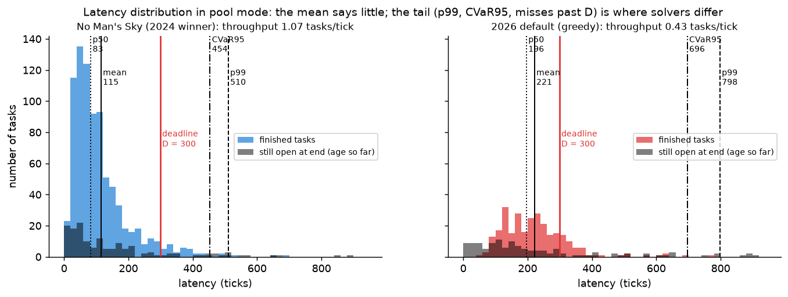

### 4.1 Throughput: the competition's score

$$\text{throughput} = \frac{\#\text{tasks finished}}{T} \quad[\text{tasks/tick}]$$

*Meaning:* how much work gets done. *Blind spot:* it says nothing about *which* tasks wait or for how long. In the figure, No Man's Sky has 2.5× the throughput of the 2026 default, and that ratio tells you nothing about either solver's worst-served tasks.

### 4.2 Latency and its summaries

For each task, $L_j = c_j - r_j$, the time from appearing to fully done. Summaries over tasks:

| Metric | Definition | Meaning | Pitfall |
|---|---|---|---|
| `lat_mean` | average $L_j$ | typical experience | hides the tail; in pool mode it is fixed by throughput (§4.5) |
| `lat_p50` | median, $q_{0.5}(L)$ | the "normal" task | same |
| `lat_p99` | $q_{0.99}(L)$ | 1 task in 100 is slower than this | noisy with few tasks per run |
| `lat_cvar95` | **CVaR95** = the mean of the worst 5% of latencies | "when it goes badly, how badly?" | counts open tasks at their age so far, so it's a lower bound |
| `lat_max` | the worst task | starvation detector | one task decides it |

**CVaR** (conditional value at risk) is a standard risk measure. Unlike a percentile, it looks at *how bad* the bad tail is, not just where it starts:

$$\text{CVaR}_{95} = \mathbb{E}\big[L \;\big|\; L \ge q_{0.95}(L)\big]$$

### 4.3 Deadline metrics

* `miss_D` is the share of tasks with $L_j > D$, for $D \in \{100, 150, 200, 250, 300, 400, 500\}$. It only counts tasks that appeared early enough to have had the full $D$ ticks ($0.1T \le r_j \le T - D$); tasks still open count as misses. Code: [`deadline_metrics`](../lorrext/core.py#L236).
* `p99_D` is $q_{0.99}(L)$ over the same tasks, with open tasks treated as ∞.
* `miss_D ≤ 1%` holds exactly when `p99_D ≤ D`. Both describe "a 99% on-time promise".

### 4.4 Normalised latency (stretch)

Tasks differ: a 5-errand task across the map, with a stove in the middle, *should* take longer than a 2-errand one next door. So divide by what the task needs on its own:

$$\text{stretch}_j = \frac{L_j}{\displaystyle\sum_{\ell=1}^{k_j-1} d(e_{j,\ell}, e_{j,\ell+1}) \;+\; \sum_{\ell=1}^{k_j} \mathbb{E}\big[\mathcal{S}_{e_{j,\ell}}\big]}$$

The denominator is the task's own path plus its expected work ([`task_length`](../lorrext/core.py#L200), [`expected_service`](../lorrext/core.py#L206)). A stretch of 1 means the task was handled as fast as physically possible, ignoring the drive to errand 1. Example in pool mode: median stretch is 1.8 for No Man's Sky and 4.4 for the 2026 default. Reported as `stretch_p50` and `stretch_p99`.

### 4.5 Open tasks and Little's law

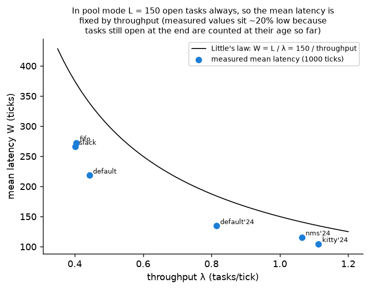

`open_mean` is the average number of open tasks. **Little's law** links three quantities in any steady system: open tasks = arrival rate × mean time in system. In pool mode there are always 150 open tasks, and tasks arrive exactly as fast as they finish (rate = throughput), so

$$\overline{L} = \frac{150}{\text{throughput}}.$$

The mean latency is just throughput in disguise. That is why we look at the tail. The measured means sit about 20% below the curve because tasks still open at the end of a run are counted at their age so far. With arrival processes, `open_mean` growing over a run is the sign of an **overloaded** system.

### 4.6 Capacity and the SLA gap: benchmark-level metrics


These need a sweep over arrival rates $\lambda$, i.e. arrival processes, not the pool:

* **Deadline-feasible capacity**: the highest tested $\lambda$ at which `miss_D ≤ 1%`. "How much load can this solver take and still keep a 99% on-time promise?" Code: [`analyze.capacity`](../lorrext/analyze.py#L60).
* **SLA gap** (service-level agreement gap):
  $$G = 1 - \frac{\text{capacity}}{\text{pool throughput}}.$$
  This is the share of leaderboard throughput you *can't* use once you promise a deadline. $G = 0$: the leaderboard number is fully usable. $G = 1$: none of it is. Code: [`analyze.table`](../lorrext/analyze.py#L75).
* **Low-load failure**: the solver keeps the promise at some load but breaks it at a *lower* one. The red band in the figure is No Man's Sky at 0.05 tasks/tick: about 3% late, with a 95% interval of 2.4–3.7%.

Note the error bars. With 3 seeds, many points near the 1% line are not statistically resolved. Capacity values should be read as rough until more seeds are run.

### 4.7 Health metrics

* `planner_errors`: invalid moves.
* `schedule_errors`: invalid assignments; a few benign ones come from a race in the 2026 kit.
* `timeouts`: the planner overran its budget.
* `wall_s`: run time.

Non-zero planner errors or timeouts mean the solver wasn't playing by the rules or was starved of CPU.

### 4.8 Is this all? What else matters

The metrics above judge **outcomes per task**. Things they don't capture yet, roughly in order of importance for your question:

1. **Where the latency goes.** Waiting for a robot vs driving vs stuck vs working. Today this needs a replay and `lorrext.diagnose`. It explains *why* a solver misses deadlines, and it is how the idle-robot blocking was found. Worth promoting to a per-run metric.
2. **Uncertainty of the estimate.** 95% confidence intervals over seeds (the seed is the unit, since tasks within a run aren't independent), and a capacity defined by the *upper* end of the interval. Needed before any claim.
3. **Robot utilisation.** The share of robot-ticks that are idle, moving, turning, waiting while busy, or working. It shows wasted capacity: busy robots in the 2026 kit wait on 50% of ticks, against 10% for No Man's Sky.
4. **Stability over time.** Is the number of open tasks flat or growing? A solver can look fine over 1000 ticks and still be heading for collapse.
5. **Robustness curves.** How miss rate and capacity change as service-time spread (cv) or delay chance $p_v$ grows. This is the "efficient even if there's some delay" part of your goal.
6. **Prediction quality.** How well the travel interval of §3.7 covers actual legs (does the 90% band hold 90% of legs?), per planner and load.
7. **Guarantees vs measurements.** Everything here is *measured*. A planner that *certifies* in advance that "this task finishes within $D$ with probability ≥ 99%", given the known distributions, would be scored on whether the certificate holds (calibration) and on how tight it is.
8. **Fairness across task types**, e.g. long vs short tasks, or tasks far from the robots. Stretch partly covers this.
9. **Compute cost.** Planning time per tick vs quality. No Man's Sky uses 32 threads.

---

## 5. Running it

```bash
# one pool-mode run (the default), full log kept for replay
uv run python -c "
from lorrext.core import run, Setting
r = run('nms2024', Setting(steps=1000), 'runs/try', screen=1)
print({k: r[k] for k in ['throughput','lat_mean','lat_p99','lat_cvar95','stretch_p50','miss_300']})"

# kitchen service map, plus congestion delays (2026 kit only)
uv run python -c "
from lorrext.core import run, Setting
print(run('fifo2026', Setting(service='kitchen', delay='congestion', steps=1000), 'runs/try')['lat_p99'])"

# inspect a run
uv run python -m lorrext.replay   validate runs/try/out/nms2024__pool1.5_none_d0_s0_T1000.json
uv run python -m lorrext.diagnose runs/try/out/nms2024__pool1.5_none_d0_s0_T1000.json   # where late tasks lose time
uv run python -m lorrext.travel   runs/try/out/nms2024__pool1.5_none_d0_s0_T1000.json   # travel-time intervals
uv run streamlit run lorrext/app.py                                                       # UI

# benchmark mode: sweep arrival rates (pool included as the reference)
python3 -m lorrext.bench --out runs/bench --only pool,poisson
```

`Setting` fields ([`core.py#L40`](../lorrext/core.py#L40)):
* `arrival` (default `pool`), `rate`, `seed`, `deadline`, `steps`;
* `service` (per-cell map, default `none`);
* `delay` (per-cell map, default `none` = deterministic);
* `p_delay` (the kit's own uniform delays, default 0);
* burst parameters for `mmpp` and `hawkes`.

---

## 6. Glossary

| Term | Meaning |
|---|---|
| tick | one simulation step; every robot does one action |
| task / errand | a job / one cell of it to visit and work at, in order |
| pool | the set of open tasks; in pool mode always 150 |
| service time | how long a robot must stay on an errand cell; drawn from that cell's distribution |
| delay | a robot stuck in place for a while; chance and length depend on its cell |
| grid distance $d(u,v)$ | fewest moves between two cells around obstacles, ignoring turns |
| cv | coefficient of variation = standard deviation / mean |
| quantile $q_\alpha$ / percentile | the value a quantity stays below with probability $\alpha$; $q_{0.95}$ = 95th percentile |
| latency | completion − reveal time of a task |
| CVaR95 | mean of the worst 5% |
| stretch | latency / (task's own path + expected work) |
| prediction interval | a range that new values fall in with a given probability, from the quantiles of past values |
| capacity | highest load with ≤ 1% deadline misses |
| SLA gap $G$ | 1 − capacity / leaderboard throughput |
| opened task | its first errand is done; it can no longer change robot |
| PIBT | Priority Inheritance with Backtracking, the one-step collision-free planner most solvers build on |
| LNS | large neighbourhood search: repeatedly re-plan small groups, keep improvements |
| MAPD | multi-agent pickup and delivery: the task-assignment plus path-planning problem studied here |
