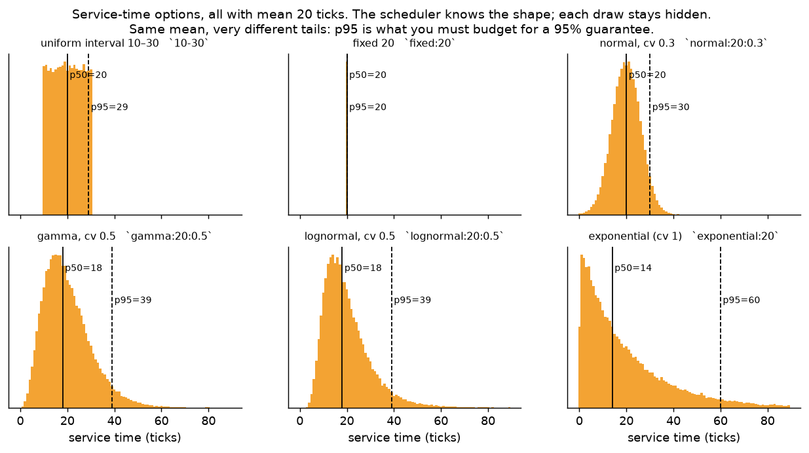
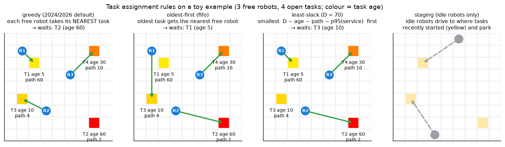
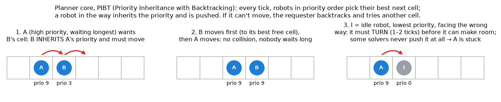
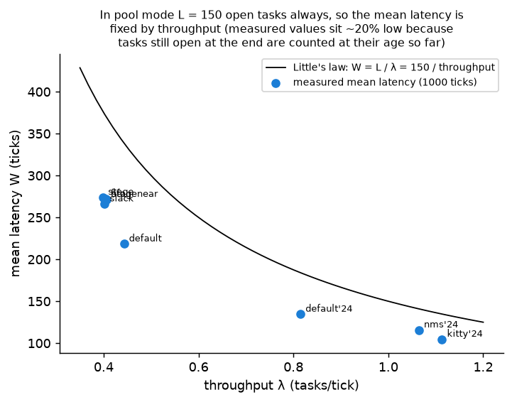
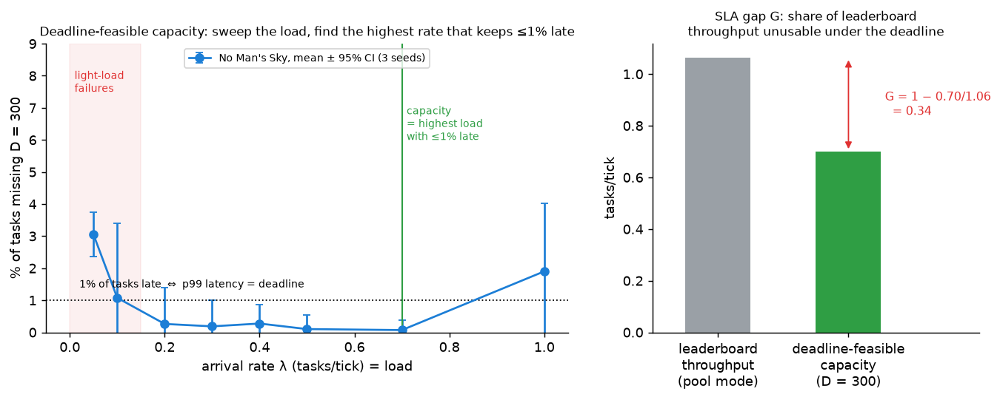

# How LoRR-Ext works: problem, environment, algorithms, metrics

This is a guided tour for someone new to the code. Each section goes **intuition → a little math → the code**. Figures are generated by [`docs/make_figures.py`](make_figures.py) from real runs, so the numbers in them are real.

Code links point to:
* this repository (`ext/`, `lorrext/`, `tools/`);
* the official Start-Kit at tag [v3.1.0](https://github.com/MAPF-Competition/Start-Kit/tree/v3.1.0) (the 2026 kit);
* the [Code-Archive](https://github.com/MAPF-Competition/Code-Archive) (2024 entries).

`scripts/setup.sh` places local copies under `third_party/` and `kits/`.

Contents
1. [The problem in one picture](#1-the-problem-in-one-picture)
2. [The environment](#2-the-environment)
3. [The algorithms](#3-the-algorithms)
4. [The metrics](#4-the-metrics)
5. [Running it](#5-running-it)
6. [Glossary](#6-glossary)

---

## 1. The problem in one picture


**Intuition.** A warehouse (or kitchen) floor is a grid. 100 robots drive around. Jobs keep coming in. Each job, called a **task**, is a short list of cells the robot must visit in order: pick something up here, drop it there, and so on. Two decisions are made over and over:

1. **Assignment:** which robot should do which task?
2. **Path planning:** which way should every robot move *this tick* so that nobody collides?

The competition this is built on, the [League of Robot Runners](https://www.leagueofrobotrunners.org/) (LoRR), scores you on **how many tasks you finish** in a fixed time. Our question is different: **can every task finish within a deadline, even when task durations are uncertain?**

**A little math.**

| Symbol | Meaning |
|---|---|
| $G = (V, E)$ | the grid: $V$ = free cells, $E$ = moves between neighbouring cells |
| $i = 1..m$ | robots ($m = 100$); robot $i$ at tick $t$ has a cell $v_i(t)$ and a heading $\theta_i(t) \in \{E,S,W,N\}$ |
| task $j$ | an ordered list of **errands** $(e_{j,1}, \dots, e_{j,k_j})$, cells to visit in order ($k_j = 2..5$ here), plus a reveal time $r_j$ |
| $s_{j,\ell}$ | **service time**: how long the robot must stay on errand $\ell$ (0 in the original competition; LoRR-Ext draws it from a known distribution) |
| $c_j$ | completion time: when the last errand is done |
| $L_j = c_j - r_j$ | **latency** of task $j$ |

Each tick $t$ the system chooses:

* an assignment $\sigma_t : \text{robots} \to \text{open tasks} \cup \{\text{none}\}$;
* one action per robot $a_i(t) \in \{F, R, C, W\}$ (forward, turn right, turn left, wait), such that no two robots end in the same cell or swap cells.

The objectives being compared:

$$\textbf{Competition: } \max \; \frac{\#\{j : c_j \le T\}}{T} \quad\text{(throughput, tasks per tick)}$$

$$\textbf{LoRR-Ext: } \text{keep } \Pr[L_j > D] \le \varepsilon \text{ (e.g. at most 1\% of tasks later than } D = 300\text{ ticks), and ask: up to what load can a solver keep that promise?}$$

**What the solver knows and doesn't know:**

| | Known in advance | Revealed online | Never revealed |
|---|---|---|---|
| Map, robot starts | ✓ | | |
| Tasks | the *process* they come from (pool, or an arrival-rate model) | each task when it appears | |
| Travel time | deterministic: 1 tick per move or turn (2026 kit: plus optional random delays) | | |
| Service time (LoRR-Ext) | the **distribution** per errand slot | | the actual draw: the robot just has to wait until it's done |

This is a *lifelong, online* version of the problem known as **multi-agent pickup and delivery (MAPD)**. "Lifelong" means it never ends, and "online" means tasks are only known once they appear.

---

## 2. The environment

### 2.1 The simulation loop


Every tick:
1. The **task manager** keeps the set of open tasks (the *pool*). It checks whether any robot just reached its next errand, and reveals new tasks.
2. The **scheduler** proposes `proposed_schedule[robot] = task id` (or -1). It can only re-assign tasks that haven't been started.
3. The **planner** turns each robot's current goal (its task's next errand) into actions.
4. The **simulator** applies the actions, rejects collisions, and advances time.

Code (2026 kit):
* the loop: [`BaseSystem::simulate`](https://github.com/MAPF-Competition/Start-Kit/blob/v3.1.0/src/CompetitionSystem.cpp#L117);
* scheduler then goals then planner: [`Entry::compute`](https://github.com/MAPF-Competition/Start-Kit/blob/v3.1.0/src/Entry.cpp#L21);
* goal = next errand: [`update_goal_locations`](https://github.com/MAPF-Competition/Start-Kit/blob/v3.1.0/src/Entry.cpp#L35);
* errand reached / task done: [`check_finished_tasks`](https://github.com/MAPF-Competition/Start-Kit/blob/v3.1.0/src/TaskManager.cpp#L131);
* reveal: [`reveal_tasks`](https://github.com/MAPF-Competition/Start-Kit/blob/v3.1.0/src/TaskManager.cpp#L187).

### 2.2 Robots and moves


A robot has a cell **and a heading**. `F` moves one cell in the heading direction, `R`/`C` rotate 90° on the spot, and `W` waits. Turning costs a tick, so a robot facing the wrong way needs 1–2 extra ticks before it can move. This matters for how quickly a robot can get out of someone's way (§3.4).

Code: move deltas east/south/west/north are [`moves[0..3]`](https://github.com/MAPF-Competition/Start-Kit/blob/v3.1.0/inc/ActionModel.h#L16), and the forward step is [`ActionModel.cpp#L476`](https://github.com/MAPF-Competition/Start-Kit/blob/v3.1.0/src/ActionModel.cpp#L476).

### 2.3 Time: two kits, two clocks

| | 2024 kit (No Man's Sky, Kitty_Knight, 2024 default) | 2026 kit (2026 default + our baselines) |
|---|---|---|
| How time passes | the simulator **waits** for the planner each tick (up to a budget; we use 100 ms) | **real time**: a tick every 30 ms whether or not the planner is done; the planner sends a multi-step plan every 300 ms |
| A move takes | 1 tick | `agentCounter` ticks (we set 1 so both kits agree) |
| Random move delays | no | yes, optional (`delayConfig`) |

Because of this, the same greedy idea gets 0.81 tasks/tick in the 2024 kit and 0.44 in the 2026 kit. **Compare solvers within a kit.**

### 2.4 Where tasks come from: the pool (default)


**Pool mode** is the competition's setting and our default. The kit keeps exactly `numTasksReveal × robots` = 1.5 × 100 = **150 tasks open** at all times. The moment one finishes, the next task from the task file appears. Two consequences:

* There is always more work than robots (150 tasks for 100 robots), so robots are never idle for long, and at least 50 tasks are always waiting.
* A task's latency includes the time it waits in the pool before any robot takes it. So in pool mode latency measures **the order in which the pool is served**, not just driving time.

**Arrival processes** are optional, for benchmarking. Tasks then appear at random times with a known mean rate λ (tasks per tick):
* Poisson: steady;
* MMPP (Markov-modulated Poisson): calm periods and bursts at 4× the rate;
* Hawkes: each task makes more tasks likely soon after.

Sweeping λ is how we find the highest load a solver can handle under a deadline (§4.6). Code: [`LorrExt::draw_arrivals`](../ext/lorr_ext.h#L263) and [`LorrExt::reveal`](../ext/lorr_ext.h#L303). Select a process with `Setting(arrival="poisson", rate=0.3)`.

### 2.5 The life of one task


A real task from a No Man's Sky run (pool mode, kitchen service times). Grey: waiting in the pool. Blue: on the way to the next errand (moving *or* blocked by other robots). Orange: being served on the errand cell. Latency is the whole bar.

### 2.6 Service times: intervals or distributions (new)



**Intuition.** Cooking takes "about 20 seconds", but sometimes 8 and sometimes 40. The scheduler knows the *shape* of that uncertainty (the distribution) but not the actual value for a given task. The robot simply has to stay on the errand cell until the job is done.

**Rule.** Errand $\ell$ of a task uses slot $\ell \bmod n$ of the spec, and its duration is drawn as

$$s_{j,\ell} \sim \mathcal{D}_{\ell \bmod n}, \qquad \text{rounded to whole ticks, clamped to } [\min, \max].$$

The robot accumulates ticks on the cell; being pushed off pauses the clock. Every solver sees the *same* draw for the same task, because the draw is seeded from (seed, task, errand), not from solver behaviour.

**Spec syntax** (`Setting.service`, or the UI's service picker):

| Spec | Meaning |
|---|---|
| `none` | instantaneous (the original competition) |
| `10-30` | uniform integer interval (the "interval" setting) |
| `lognormal:20:0.5` | mean 20, coefficient of variation (sd/mean) 0.5 |
| `gamma:20:0.5:1:120` | the same shape family plus bounds [1, 120] |
| `exponential:20`, `normal:20:0.3`, `fixed:20` | other shapes |
| `lognormal:3:0.3;gamma:20:0.5` | two slots: errands 1, 3, 5 use the first, errands 2, 4 use the second |
| presets `kitchen`, `kitchen_dist`, `kitchen_exp` | `2-4;10-30`, `lognormal:3:0.3;lognormal:20:0.5`, `exponential:3;exponential:20` |

**What a scheduler may read:** `LorrExt::service_mean(slot)` and `LorrExt::service_quantile(slot, q)`. Never the draw.

Code: [`ServiceDist`](../ext/lorr_ext.h#L40) (`draw` at [L72](../ext/lorr_ext.h#L72)), [`service_time`](../ext/lorr_ext.h#L251), [`service_quantile`](../ext/lorr_ext.h#L238), [`stop_reached`](../ext/lorr_ext.h#L331) (the dwell check), and the spec parser [`service_stops`](../lorrext/core.py#L78).

Checked: the C++ quantiles equal the Python sampler's, and dwell times observed in replays match. For the cooking slot, q05/q50/q95 is 8/18/39 configured and 8/18/35–38 observed. This is tested in `tests/test_lorrext.py::test_service_distribution_end_to_end`.

**Travel time** stays deterministic (1 tick per action, plus the 2026 kit's optional random delays). Making it a distribution would be a hook in the same place (`stop_reached` and the simulator's move step).

### 2.7 What LoRR-Ext changes in the kit

Four small hooks, applied by [`tools/patch_kit.py`](../tools/patch_kit.py):
1. the reveal loop calls `LorrExt::reveal` (arrival processes; does nothing in pool mode);
2. the "robot is on its errand" test calls `LorrExt::stop_reached` (service time);
3. the driver reads the `lorrExt` block from the instance JSON;
4. the results writer adds per-task records `[id, revealed, completed, robot, #errands]`.

With no `lorrExt` block, the kit behaves exactly as released.

---

## 3. The algorithms

Every solver has the same two layers: a **scheduler** (assignment) and a **planner** (moves).

| Solver | Kit | Scheduler | Planner |
|---|---|---|---|
| 2026 default | 2026 | greedy: each free robot takes its nearest task | traffic-flow-guided PIBT |
| 2024 default | 2024 | greedy (same idea) | traffic-flow-guided PIBT |
| oldest-first (`fifo2026`) | 2026 | oldest task gets the nearest free robot | 2026 default planner |
| least-slack (`slack2026`) | 2026 | most urgent task first (deadline, path, p95 service) | 2026 default planner |
| staging (`stage2026`, `stagenear2026`) | 2026 | oldest-first, and idle robots park where tasks recently started | 2026 default planner |
| No Man's Sky (2024 1st) | 2024 | simulated-annealing assignment, may swap unstarted tasks | 32 randomized PIBT runs in parallel, keep the best, plus guidance |
| Kitty_Knight (2024 2nd) | 2024 | global greedy matching (closest robot-task pair first) | windowed large-neighbourhood search (WPPL) |

### 3.1 Schedulers at a glance



Same situation, three rules, three different tasks left waiting:

* **Greedy** (both defaults). Each free robot, in turn, takes the task with the shortest *robot → errand 1 → … → last errand* distance:

  $$\sigma(i) = \arg\min_{j \in \text{free}} \Big[ d(v_i, e_{j,1}) + \textstyle\sum_\ell d(e_{j,\ell}, e_{j,\ell+1}) \Big]$$

  It is good for throughput because there's little empty driving. It is bad for fairness: a task that is far from everyone is never anyone's best choice, so in pool mode it can wait a very long time. The 2026 default's p99 in pool mode is 798 ticks, against 514 for oldest-first. Code: [`schedule_plan`](https://github.com/MAPF-Competition/Start-Kit/blob/v3.1.0/default_planner/scheduler.cpp#L23).
* **Oldest-first** (ours). Sort open tasks by reveal time, and give each the nearest free robot. No task waits forever. Code: [`LorrExtSched::plan`](../ext/ext_scheduler.cpp#L71).
* **Least-slack** (ours). Sort by
  $$\text{slack}_j = D - \text{age}_j - \text{path}_j - \textstyle\sum_\ell q_{0.95}(s_{j,\ell}).$$
  Slack is how much spare time the task has if served now, *budgeting the 95th percentile* of each remaining service time. This is the scheduler that actually uses the known distribution. Code: [`ext_scheduler.cpp#L110`](../ext/ext_scheduler.cpp#L110) and [`safe_service`](../ext/ext_scheduler.cpp#L46).
* **Staging** (ours). Like oldest-first, but robots with nothing to do drive to the start cells of recently revealed tasks (or a free neighbouring cell) and wait there. The idea is to be closer when the next task arrives. It backfires (§3.4). Code: [`ext_scheduler.cpp#L151`](../ext/ext_scheduler.cpp#L151).
* **No Man's Sky.** A local search with simulated annealing over the whole assignment. Its cost per robot is about $5 \cdot d(\text{robot}, \text{errand}_1) + \text{task length}$, so it penalises empty driving 5× ([`scheduler_solver.cpp#L63`](https://github.com/MAPF-Competition/Code-Archive/blob/main/2024%20Competition/Team_No_Man's_Sky/44950d1b61b7482b4529a9dc127fa9d220962bdc/Solution/Scheduler/scheduler_solver.cpp#L63)). It re-optimises every tick and may move an *unstarted* task to a better robot ([`ENABLE_SCHEDULER_CHANGE_TASK`](https://github.com/MAPF-Competition/Code-Archive/blob/main/2024%20Competition/Team_No_Man's_Sky/44950d1b61b7482b4529a9dc127fa9d220962bdc/Solution/settings.hpp#L43)).
* **Kitty_Knight.** Global greedy matching: among all (free robot, free task) pairs, repeatedly pick the closest pair ([`greedy_matching2`](https://github.com/MAPF-Competition/Code-Archive/blob/main/2024%20Competition/Team_Kitty_Knight/da7d428b40cc1425b381adefe9709d4accbfdfe1/wppl_planner/src/scheduler.cpp#L368)). It assumes there are always more tasks than robots and calls `exit(-1)` otherwise; this repo adds a labelled guard.

### 3.2 Planners: PIBT, the common core



**PIBT (Priority Inheritance with Backtracking)**, one tick:
1. Sort robots by priority. In the default planner, a robot's priority grows by 1 each planning round while it keeps the same goal, resets when it gets a new goal, and gets +10 in a dead end ([`planner.cpp#L153-L161`](https://github.com/MAPF-Competition/Start-Kit/blob/v3.1.0/default_planner/planner.cpp#L153-L161)). A robot that has been trying to reach its goal for a long time therefore wins conflicts, while idle robots keep the lowest priority.
2. The highest-priority robot picks its best neighbouring cell, the one closest to its goal.
3. If another robot sits there, that robot **inherits** the priority and must move first: recursively, pick *its* best free cell.
4. If it can't move anywhere, the request fails and the first robot **backtracks** and tries its next-best cell.

Code: [`causalPIBT`](https://github.com/MAPF-Competition/Start-Kit/blob/v3.1.0/default_planner/pibt.cpp#L44) and the per-tick loop [`run_multistep_pibt_once`](https://github.com/MAPF-Competition/Start-Kit/blob/v3.1.0/default_planner/planner.cpp#L225).

On top of PIBT:
* **Traffic-flow guidance** (both defaults). Before PIBT, compute a *guide path* for every robot that spreads traffic over the map (a Frank-Wolfe optimisation over edge congestion, [`frank_wolfe`](https://github.com/MAPF-Competition/Start-Kit/blob/v3.1.0/default_planner/flow.cpp#L94)). PIBT then measures "closer to the goal" along that guide path. Reference: Chen et al., *Traffic Flow Optimisation for Lifelong MAPF*, AAAI 2024.
* **No Man's Sky.** It runs **32 randomized PIBT variants in parallel** ([`THREADS = 32`](https://github.com/MAPF-Competition/Code-Archive/blob/main/2024%20Competition/Team_No_Man's_Sky/44950d1b61b7482b4529a9dc127fa9d220962bdc/Solution/settings.hpp#L57), [`eplanner.cpp#L36`](https://github.com/MAPF-Competition/Code-Archive/blob/main/2024%20Competition/Team_No_Man's_Sky/44950d1b61b7482b4529a9dc127fa9d220962bdc/Solution/Planner/eplanner.cpp#L36)), scores each, keeps the best, and improves each robot's preferred direction by annealing. This is why it uses about 10 cores if you let it; the benchmark pins every run to 2.
* **Kitty_Knight (WPPL).** It plans a 20-tick **window** for everyone (initial solution from LaCAM2, a fast PIBT-style search). It then repeatedly destroys and re-plans small groups of robots (8 at a time) with prioritized planning plus SIPP (safe-interval path planning), keeping changes that shorten paths. This is large neighbourhood search (LNS). Config: [`random-32-32-20.json`](https://github.com/MAPF-Competition/Code-Archive/blob/main/2024%20Competition/Team_Kitty_Knight/da7d428b40cc1425b381adefe9709d4accbfdfe1/wppl_planner/configs/random-32-32-20.json).

### 3.3 What idle robots do

This detail turns out to matter most:

* **2026 default.** A robot with no task gets a *placeholder goal: its initial start cell* ([`planner.cpp#L99`](https://github.com/MAPF-Competition/Start-Kit/blob/v3.1.0/default_planner/planner.cpp#L99)). Idle robots drive back there and park, with the lowest priority.
* **Staging.** Idle robots park on (or next to) recent pickup cells, deliberately.
* **Others.** Each entry handles idle robots in its own way.

### 3.4 How each one fails (observed)

From `python -m lorrext.diagnose` on replays (each late task's time split into waiting for a robot, moving, stuck, and being served):

* **Kitty_Knight, 2024 default, staging, at light load.** 80–90% of a late task's time is spent with its robot **stuck**, and 68–89% of that with an **idle robot right next to it**. Idle robots don't make room (turning costs ticks, and some planners never push them), so busy robots get boxed in. Some tasks never finish. In pool mode there are never idle robots, so the competition can't see this.
* **2026 default.** Its late tasks are stuck among *busy* robots: congestion.
* **No Man's Sky.** At most one late task per run at light and moderate load.

---

## 4. The metrics

All metrics are computed per run in [`lorrext/core.py::metrics`](../lorrext/core.py#L279) from the per-task records. The first 10% of ticks are skipped as warm-up.


### 4.1 Throughput: the competition's score

$$\text{throughput} = \frac{\#\text{tasks finished}}{T} \quad[\text{tasks/tick}]$$

*Meaning:* how much work gets done. *Blind spot:* it says nothing about *which* tasks wait or for how long. In the figure, No Man's Sky has 2.5× the throughput of the 2026 default, and that ratio tells you nothing about either solver's worst-served tasks.

### 4.2 Latency and its summaries

For each task, $L_j = c_j - r_j$, the time from appearing to fully done. Summaries over tasks:

| Metric | Definition | Meaning | Pitfall |
|---|---|---|---|
| `lat_mean` | average $L_j$ | typical experience | hides the tail; in pool mode it is fixed by throughput (§4.5) |
| `lat_p50` | median | the "normal" task | same |
| `lat_p99` | 99th percentile | 1 task in 100 is slower than this | noisy with few tasks per run |
| `lat_cvar95` | **CVaR95** = the mean of the worst 5% of latencies | "when it goes badly, how badly?" | counts open tasks at their age so far, so it's a lower bound |
| `lat_max` | the worst task | starvation detector | one task decides it |

**CVaR** (conditional value at risk) is a standard risk measure. Unlike a percentile, it looks at *how bad* the bad tail is, not just where it starts:

$$\text{CVaR}_{95} = \mathbb{E}\big[L \mid L \ge \text{p95}(L)\big]$$

### 4.3 Deadline metrics

* `miss_D` is the share of tasks with $L_j > D$, for $D \in \{100, 150, 200, 250, 300, 400, 500\}$. It only counts tasks that appeared early enough to have had the full $D$ ticks (revealed in $[0.1T,\, T-D]$); tasks still open count as misses. Code: [`deadline_metrics`](../lorrext/core.py#L267).
* `p99_D` is the 99th percentile over the same tasks, with open tasks treated as ∞.
* `miss_D ≤ 1%` holds exactly when `p99_D ≤ D`. Both describe "a 99% on-time promise".

### 4.4 Normalised latency (stretch)

Tasks differ: a 5-errand task across the map *should* take longer than a 2-errand one next door. So divide by what the task needs on its own:

$$\text{stretch}_j = \frac{L_j}{\text{path}_j + \mathbb{E}[\text{service}_j]}, \qquad \text{path}_j = \sum_\ell d(e_{j,\ell}, e_{j,\ell+1})$$

Here $d$ is the shortest number of moves on the map, ignoring turns ([`task_length`](../lorrext/core.py#L232)). A stretch of 1 means the task was handled as fast as physically possible, ignoring the drive to errand 1. Example in pool mode: median stretch is 1.8 for No Man's Sky and 4.4 for the 2026 default. Reported as `stretch_p50` and `stretch_p99`.

### 4.5 Open tasks and Little's law



`open_mean` is the average number of open tasks. **Little's law** links three quantities in any steady system: open tasks $L$ = arrival rate $\lambda$ × mean time in system $W$. In pool mode $L = 150$ always, so

$$\overline{\text{latency}} = \frac{150}{\text{throughput}}.$$

The mean latency is just throughput in disguise. That is why we look at the tail. The measured means sit about 20% below the curve because tasks still open at the end of a run are counted at their age so far. With arrival processes, `open_mean` growing over a run is the sign of an **overloaded** system.

### 4.6 Capacity and the SLA gap: benchmark-level metrics



These need a sweep over arrival rates, i.e. arrival processes, not the pool:

* **Deadline-feasible capacity**: the highest tested rate λ at which `miss_D ≤ 1%`. "How much load can this solver take and still keep a 99% on-time promise?" Code: [`analyze.capacity`](../lorrext/analyze.py#L56).
* **SLA gap** (service-level agreement gap):
  $$G = 1 - \frac{\text{capacity}}{\text{pool throughput}}.$$
  This is the share of leaderboard throughput you *can't* use once you promise a deadline. $G = 0$: the leaderboard number is fully usable. $G = 1$: none of it is. Code: [`analyze.table`](../lorrext/analyze.py#L71).
* **Low-load failure**: the solver keeps the promise at some load but breaks it at a *lower* one. The red band in the figure is No Man's Sky at 0.05 tasks/tick: about 3% late, with a 95% interval of 2.4–3.7%.

Note the error bars. With 3 seeds, many points near the 1% line are not statistically resolved. Capacity values should be read as rough until more seeds are run.

### 4.7 Health metrics

* `planner_errors`: invalid moves.
* `schedule_errors`: invalid assignments; a few benign ones come from a race in the 2026 kit.
* `timeouts`: the planner overran its budget.
* `wall_s`: run time.

Non-zero planner errors or timeouts mean the solver wasn't playing by the rules or was starved of CPU.

### 4.8 Is this all? What else matters

The metrics above judge **outcomes per task**. Things they don't capture yet, roughly in order of importance for your question:

1. **Where the latency goes.** Waiting for a robot vs driving vs stuck vs being served. Today this needs a replay and `lorrext.diagnose`. It explains *why* a solver misses deadlines, and it is how the idle-robot blocking was found. Worth promoting to a per-run metric.
2. **Uncertainty of the estimate.** 95% confidence intervals over seeds (the seed is the unit, since tasks within a run aren't independent), and a capacity defined by the *upper* end of the interval. Needed before any claim.
3. **Robot utilisation.** The share of robot-ticks that are idle, moving, turning, waiting while busy, or serving. It shows wasted capacity: busy robots in the 2026 kit wait on 50% of ticks, against 10% for No Man's Sky.
4. **Stability over time.** Is the number of open tasks flat or growing? A solver can look fine over 1000 ticks and still be heading for collapse.
5. **Robustness curves.** How miss rate and capacity change as service-time variance (the cv) or move-delay probability grows. This is the "efficient even if there's some delay" part of your goal.
6. **Guarantees vs measurements.** Everything here is *measured*. A planner that *certifies* in advance that "this task finishes within D with probability ≥ 99%", given the known distributions, would be scored on whether the certificate holds (calibration) and on how tight it is.
7. **Fairness across task types**, e.g. long vs short tasks, or tasks far from the robots. Stretch partly covers this.
8. **Compute cost.** Planning time per tick vs quality. No Man's Sky uses 32 threads.

---

## 5. Running it

```bash
# one pool-mode run (the default), full log kept for replay
uv run python -c "
from lorrext.core import run, Setting
r = run('nms2024', Setting(steps=1000), 'runs/try', screen=1)
print({k: r[k] for k in ['throughput','lat_mean','lat_p99','lat_cvar95','stretch_p50','miss_300']})"

# same, with cooking-time distributions
uv run python -c "
from lorrext.core import run, Setting
print(run('fifo2026', Setting(service='kitchen_dist', steps=1000), 'runs/try')['lat_p99'])"

# inspect it
uv run python -m lorrext.replay validate runs/try/out/nms2024__pool1.5_none_d0_s0_T1000.json
uv run python -m lorrext.diagnose      runs/try/out/nms2024__pool1.5_none_d0_s0_T1000.json
uv run streamlit run lorrext/app.py    # Replay / Compare tabs

# benchmark mode: sweep arrival rates (pool included as the reference)
python3 -m lorrext.bench --out runs/bench --only pool,poisson
```

`Setting` fields ([`core.py#L38`](../lorrext/core.py#L38)): `arrival` (default `pool`), `rate`, `service`, `p_delay`, `seed`, `deadline`, `steps`, plus burst parameters for `mmpp` and `hawkes`.

---

## 6. Glossary

| Term | Meaning |
|---|---|
| tick | one simulation step; every robot does one action |
| task / errand | a job / one cell of it to visit, in order |
| pool | the set of open tasks; in pool mode always 150 |
| service time | how long a robot must stay on an errand cell |
| cv | coefficient of variation = standard deviation / mean |
| latency | completion − reveal time of a task |
| p99 | 99th percentile: 99% of values are below it |
| CVaR95 | mean of the worst 5% |
| stretch | latency / (task's own path + expected service) |
| capacity | highest load with ≤ 1% deadline misses |
| SLA gap G | 1 − capacity / leaderboard throughput |
| PIBT | Priority Inheritance with Backtracking, the one-step collision-free planner most solvers build on |
| LNS | large neighbourhood search: repeatedly re-plan small groups, keep improvements |
| MAPD | multi-agent pickup and delivery: the task-assignment plus path-planning problem studied here |
