# How the planners work in the LoRR setting

A visual guide to the **planner**: the part of each solver that turns "robot $i$ should go to cell $g_i$" into the next moves of every robot, without collisions. The scheduler (who does which task) is covered in [the explainer](explainer.md#3-the-algorithms). This document goes one level deeper on the planner side.

Each section goes **intuition → a little math or pseudo-code → figure → the code**. Figures come from [`docs/make_planning_figures.py`](make_planning_figures.py). Most are schematic drawings. Three are computed: §3.3's two figures, which run the 2026 default's route cost on the real benchmark map, and §5's action mix, which comes from real runs.

Code links point to the Start-Kit at tag [v3.1.0](https://github.com/MAPF-Competition/Start-Kit/tree/v3.1.0) (the 2026 kit) and to the [Code-Archive](https://github.com/MAPF-Competition/Code-Archive) (2024 entries). `scripts/setup.sh` puts local copies under `kits/`.

Contents
1. [The planning problem](#1-the-planning-problem)
2. [A map of the algorithms](#2-a-map-of-the-algorithms)
3. [Building blocks](#3-building-blocks): single-robot search, PIBT, traffic guidance, SIPP, LNS, LaCAM
4. [The planners in our benchmark](#4-the-planners-in-our-benchmark)
5. [What they do in practice](#5-what-they-do-in-practice)
6. [Bringing in Kei18's planners](#6-bringing-in-kei18s-planners)
7. [Glossary and references](#7-glossary-and-references)

### Notation

| Symbol | Meaning |
|---|---|
| $m$ | number of robots (100 in our benchmark) |
| $v$, $u$ | grid cells |
| $\theta_i$ | robot $i$'s heading: E, S, W or N |
| $g_i$ | robot $i$'s current **goal**: the next errand cell of its task, or a parking cell if it has none |
| $d(u, v)$ | **grid distance**: fewest moves from $u$ to $v$ around obstacles, ignoring turns (a breadth-first search, BFS) |
| $h_i(v)$ | the **heuristic** robot $i$ uses to rank cell $v$: smaller = better, "how far from done am I if I step there" |
| $p_i$ | robot $i$'s **priority**: who wins when two robots want the same cell |
| $Q$ | a **configuration**: the cells of *all* robots at one moment |
| $F_{v,k}$ | **traffic flow**: how many robots' guide paths leave cell $v$ in direction $k$ |
| $k$ | number of steps in one 2026 plan (11 here) |

---

## 1. The planning problem

**Intuition.** Robots on a grid each have a goal. Every tick, each robot does one action. Nobody may bump into anybody. When a robot reaches its goal it immediately gets a new one, so the problem never ends. This is **lifelong multi-agent path finding** (lifelong MAPF).

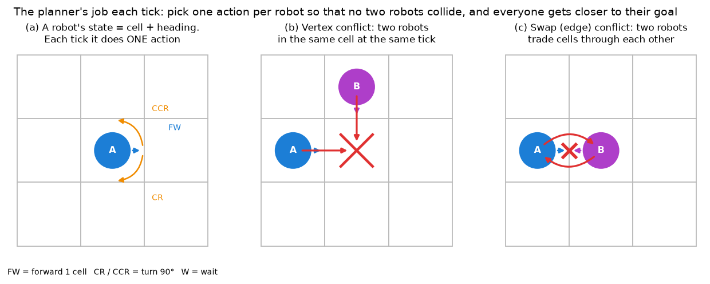

What makes LoRR harder than textbook MAPF:

| Twist | What it means for a planner |
|---|---|
| **Headings and turns** | A robot can only move the way it faces. A 90° turn costs a tick, a U-turn two. "Shortest path" in cells is not shortest in time. |
| **Goals keep changing** | A plan to the current goals goes stale within ticks. Planners re-plan constantly and rarely plan all the way to the goal. |
| **Tiny time budget** | 100 robots, and about 100 ms per tick (2024 kit) or about 300 ms per 11-tick plan (2026 kit). Optimal solvers are out. |
| **Real time and delays (2026 kit)** | The world keeps ticking while you think, and robots may be randomly delayed, so the plan you send isn't executed exactly. |

**Two kinds of collision** (panels b, c): a **vertex conflict** is two robots in one cell at the same tick. A **swap (edge) conflict** is two robots passing through each other along the same edge. Every planner below rules out both.

A **space-time diagram** is the standard way to see conflicts: put time on one axis and position on the other. Each robot is a line, crossing lines are collisions, and flat segments are waiting:

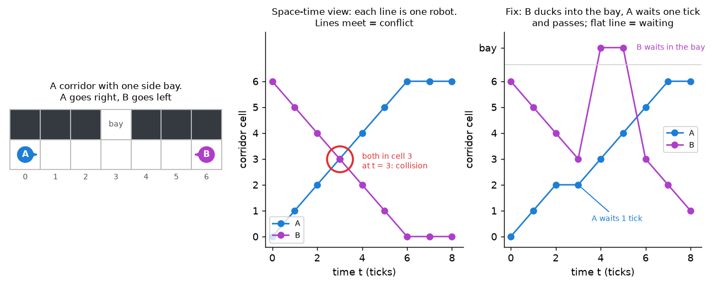

**The interface.** A planner gets every robot's cell, heading and goal list and returns actions:

```cpp
// 2026 kit: return a multi-step plan (k actions per robot)
void MAPFPlanner::plan(int time_limit, Plan& plan);
```

Code: [`MAPFPlanner::plan`](https://github.com/MAPF-Competition/Start-Kit/blob/v3.1.0/src/MAPFPlanner.cpp#L32). It asks for
$k = \lfloor 300 / 30 \rfloor + 1 = 11$ steps: the planning window divided by the tick length, plus one.

---

## 2. A map of the algorithms

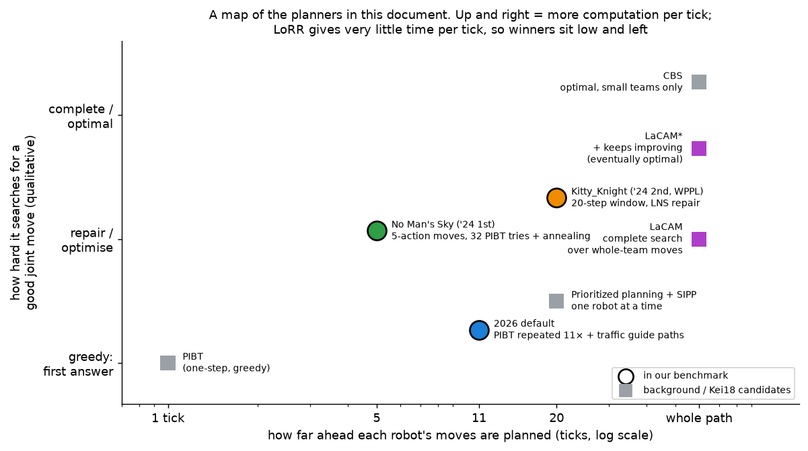

Read it as a trade-off. **Rightward** = each robot's moves are planned further ahead. **Upward** = more effort spent finding a good *joint* move. Both cost time. LoRR gives very little time, so the winners sit low and left:

* They all use **PIBT** as their core, a greedy one-step rule (§3.2).
* They add one cheap trick on top: traffic-aware guide paths (2026 default), many randomized tries plus annealing (No Man's Sky), or a short window repaired by local search (Kitty_Knight).

The upper right (LaCAM*, CBS) is where Kei18's planners and textbook optimal solvers live (§3.6, §6).

---

## 3. Building blocks

### 3.1 Single-robot search: distance tables and A*

**Intuition.** Before coordinating anyone, each robot needs to know how far every cell is from its goal. Every planner here precomputes a **distance table**: one BFS from the goal over the map gives $d(v, g)$ for every $v$. It costs one BFS per goal, cached and reused.

* **A\*** finds one robot's shortest path, guided by such a table.
* **Space-time A\*** searches over (cell, time) pairs so it can wait and dodge other robots' reserved cells.

Code: [`init_heuristic`](https://github.com/MAPF-Competition/Start-Kit/blob/v3.1.0/default_planner/heuristics.cpp#L44) (BFS tables, cached per goal) and [`astar`](https://github.com/MAPF-Competition/Start-Kit/blob/v3.1.0/default_planner/search.cpp#L11) (used for guide paths, §3.3).

### 3.2 PIBT: the common core

**Intuition.** Go robot by robot in priority order. Each robot grabs its best neighbouring cell. If someone is sitting there, that robot is *pushed*: it **inherits** the pusher's priority and must find a cell first. If a pushed robot has nowhere to go, the request fails and the pusher **backtracks** to its next choice.

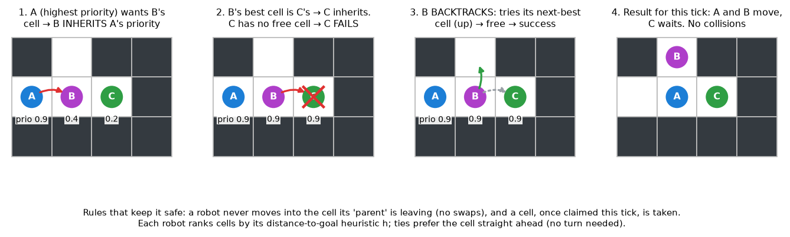

**Pseudo-code** (one tick):

```text
sort robots by priority p (high first)
for each robot i not yet decided:
    PIBT(i, parent = none)

PIBT(i, parent):
    candidates = 4 neighbours of i's cell + i's own cell (wait),
                 sorted by h_i(v); ties: the cell straight ahead, then random
    for v in candidates:
        if v already claimed this tick: skip
        if v is the parent's current cell: skip     # no swaps
        claim v for i
        j = robot currently on v
        if j exists and j is undecided:
            if not PIBT(j, parent = i): continue    # j stuck → try next v (backtrack)
        return success
    stay put; return failure
```

Why it fits LoRR: one tick for 100 robots takes about a millisecond. The highest-priority robot always gets a step closer to its goal (on maps without dead ends), and priorities rise while a robot waits, so everyone gets a turn at being first.

**How the 2026 default sets priorities** ([`planner.cpp#L153-L161`](https://github.com/MAPF-Competition/Start-Kit/blob/v3.1.0/default_planner/planner.cpp#L153-L161)):

$$p_i \leftarrow \begin{cases} p_i^{(0)} & \text{goal changed (fresh start; } p_i^{(0)} \in (0,1) \text{ random tie-break)}\\ p_i + 1 & \text{still chasing the same goal}\\ p_i + 10 & \text{additionally, if standing in a dead end} \end{cases}$$

Idle robots (no task) keep $p_i^{(0)}$, the lowest priority, so they always yield.

**Turns.** PIBT picks *cells*, not actions. The kit then converts each chosen cell into an action:

* forward, if the robot already faces that cell;
* otherwise a turn this tick, with the forward move left for later.

A forward move is also cancelled if the robot in front isn't really leaving (`moveCheck`).

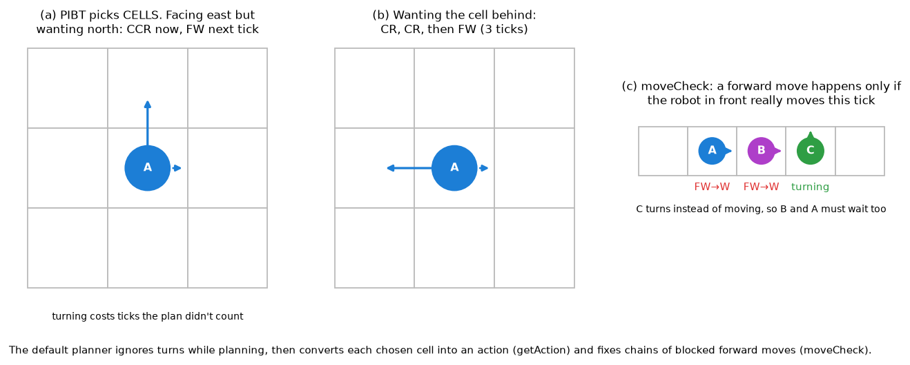

Code: [`causalPIBT`](https://github.com/MAPF-Competition/Start-Kit/blob/v3.1.0/default_planner/pibt.cpp#L44), [`getAction`](https://github.com/MAPF-Competition/Start-Kit/blob/v3.1.0/default_planner/pibt.cpp#L150), [`moveCheck`](https://github.com/MAPF-Competition/Start-Kit/blob/v3.1.0/default_planner/pibt.cpp#L184).

### 3.3 Traffic-flow guidance: steer PIBT away from head-on traffic

**Intuition.** PIBT is short-sighted: if everybody follows plain shortest paths, they pile into the same corridors from both ends and push each other back and forth. Guidance gives each robot a **guide path** that avoids traffic. PIBT then measures progress along that path instead of straight-line distance to the goal.

**Step 1: route against traffic.** The guide path is an A* path where each step $u \to v$ in direction $k$ costs

$$\text{cost}(u \to v) \;=\; 1 \;+\; \underbrace{(F_{u,k} + 1)\cdot F_{v,\bar k}}_{\text{head-on: others going the opposite way}} \;+\; \underbrace{\Big\lfloor \tfrac{1}{2}\textstyle\sum_{k'} F_{v,k'} \Big\rfloor}_{\text{crowding at } v}$$

Here $\bar k$ is the opposite direction. The kit re-routes robots one at a time against everyone else's flow until time runs out. It calls this loop `frank_wolfe` after the optimisation method it approximates.

On the benchmark map with 100 random trips, this cuts head-on encounters by 83% for an 8% longer route. A head-on pair is one robot's path using an edge in one direction while another's uses it in the other ($\sum F_{u,k} F_{v,\bar k}$):

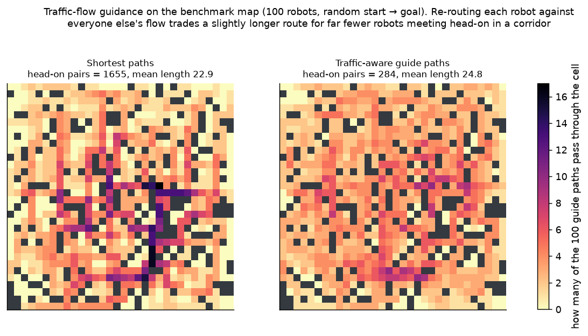

**Step 2: rank cells by the guide path.** In PIBT, robot $i$ scores a cell $v$ by

$$h_i(v) = \underbrace{\min_{w \in \text{guide path}} d(v, w)}_{\text{how far off the path}} + \underbrace{\text{steps left along the path from that } w}_{\text{how far to go}}$$

So "downhill" means: get back onto the guide path, then follow it. The arrows below show which neighbour PIBT tries first from each cell:

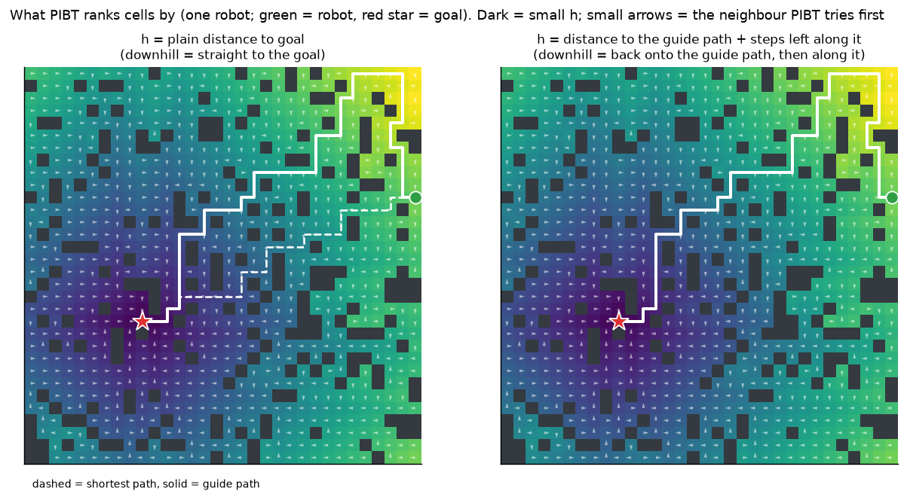

Code: cost terms in [`search.cpp#L110-L120`](https://github.com/MAPF-Competition/Start-Kit/blob/v3.1.0/default_planner/search.cpp#L110-L120), the loop [`frank_wolfe`](https://github.com/MAPF-Competition/Start-Kit/blob/v3.1.0/default_planner/flow.cpp#L94), the PIBT heuristic [`get_gp_h`](https://github.com/MAPF-Competition/Start-Kit/blob/v3.1.0/default_planner/pibt.cpp#L13) → [`get_dist_2_path`](https://github.com/MAPF-Competition/Start-Kit/blob/v3.1.0/default_planner/heuristics.cpp#L169). Reference: Chen et al., AAAI 2024.

### 3.4 SIPP: fast single-robot search around moving obstacles

**Intuition.** Space-time A* treats every (cell, tick) as a separate state: slow. But a cell's timeline is mostly free, broken by the few moments other robots pass. **Safe Interval Path Planning (SIPP)** groups each run of free ticks into one **safe interval**. A state becomes (cell, interval), and the robot arrives as early as possible within each interval. It finds the same answer as space-time A* with far fewer states.

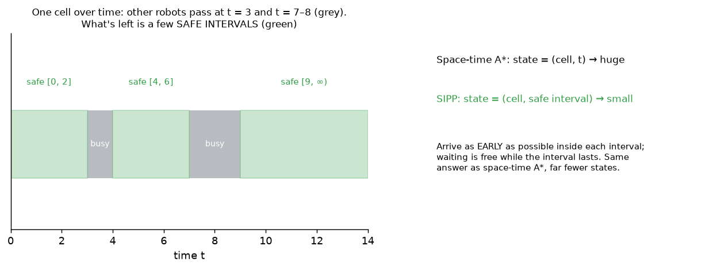

Used by Kitty_Knight to re-plan robots around everyone else's fixed paths (§4.4). Reference: Phillips & Likhachev, ICRA 2011.

### 3.5 Large Neighbourhood Search (LNS) with prioritized planning

**Intuition.** Start with any collision-free plan, then improve it piece by piece:

1. **destroy**: pick a few robots (8 here) and erase their paths;
2. **repair**: re-plan them one by one, each avoiding all the others. Re-planning robots one at a time in some order is **prioritized planning**.
3. **keep or undo**: keep the new paths if the total (sum of path costs) went down, otherwise undo.

Repeat as many times as time allows. Each iteration is small and fast, and the plan keeps improving. Reference: Li et al., *MAPF-LNS* (IJCAI 2021) and *MAPF-LNS2* (AAAI 2022).

### 3.6 LaCAM and LaCAM*: search over whole-team moves

**Intuition.** PIBT gives *one* joint move. If that move leads to a dead end (robots wedged in a corridor), PIBT has no way back. **LaCAM** turns PIBT into a proper search:

* Each node is a configuration $Q$, where everybody is.
* The children of $Q$ are generated by PIBT.
* Each time the search returns to $Q$, it **lazily adds one constraint** ("robot 1 must go up"), forcing PIBT to produce a different move.

This makes LaCAM **complete**: it will find a solution if one exists. **LaCAM\*** keeps searching after the first solution and rewires to cheaper paths, so the solution keeps improving and eventually becomes optimal.

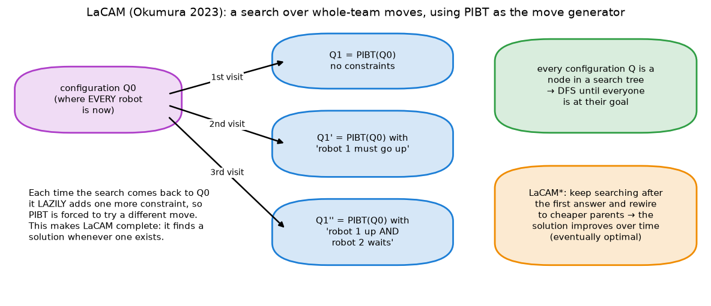

Code: [Kei18/lacam](https://github.com/Kei18/lacam) (LaCAM), [Kei18/lacam2](https://github.com/Kei18/lacam2) (LaCAM*), [Kei18/lacam3](https://github.com/Kei18/lacam3) (engineered LaCAM*). Kitty_Knight runs the lacam2 code over a 20-step window as its starting plan (§4.4). References: Okumura, AAAI 2023 and IJCAI 2023.

---

## 4. The planners in our benchmark

| Solver | Kit | Planner in one line |
|---|---|---|
| 2026 default, `fifo2026`, `slack2026` | 2026 | traffic-guided PIBT, rolled out 11 steps per call; executor keeps robots in order under delays |
| 2024 default | 2024 | traffic-guided PIBT, 1 step per tick |
| No Man's Sky | 2024 | PIBT over 5-action "operations", 32 randomized tries with annealing, best one wins |
| Kitty_Knight | 2024 | WPPL: 20-step window from LaCAM2, improved by parallel LNS with SIPP |

### 4.1 The 2026 default planner and executor

**Time.** In the 2026 kit, the planner runs on its own thread while the simulation keeps ticking:

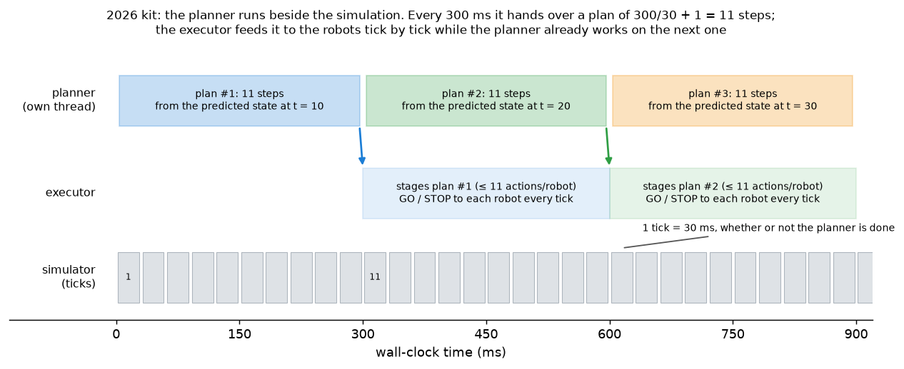

**One planner call** ([`plan`](https://github.com/MAPF-Competition/Start-Kit/blob/v3.1.0/default_planner/planner.cpp#L343)):

1. **Setup**: refresh priorities and goals. An idle robot's goal is its start cell ([`planner.cpp#L92`](https://github.com/MAPF-Competition/Start-Kit/blob/v3.1.0/default_planner/planner.cpp#L92)).
2. **Guide paths** (§3.3): give new paths to robots whose goal changed, then re-route against traffic until the flow budget runs out.
3. **Rollout**: run PIBT 11 times on an *imagined copy* of the world. Each time, record the actions and move the copy forward one tick. Restore the real state at the end.

The time split, with $n$ robots and about 290 ms left after the scheduler and a 10 ms margin:

$$\text{flow budget} = 290 - \max\big(100,\ \tfrac{n}{100}\cdot k\big) - 10 \;\approx\; 180 \text{ ms}$$

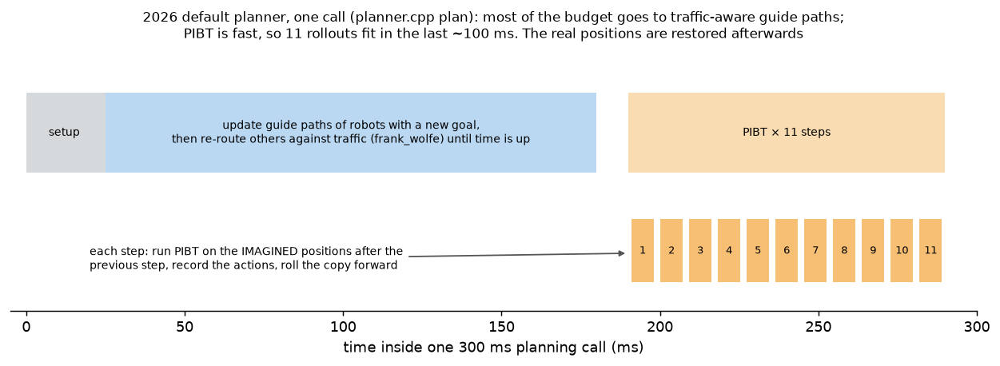

**The executor: plans are sequences, not timetables.** The plan arrives about 10 ticks after the state it was planned from, and delays can hold robots up. The executor therefore keeps, for each cell, the **order** in which robots are planned to enter it. This is a *temporal plan graph* (TPG). Each tick it says GO or STOP to each robot. A robot may enter a cell only when it is next in that cell's queue. Delays then slow robots down but never cause collisions.

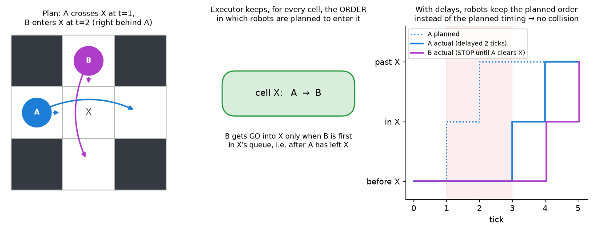

Code: [`execute_process_new_plan`](https://github.com/MAPF-Competition/Start-Kit/blob/v3.1.0/default_planner/default_executor.cpp#L31) (stage at most $k$ actions, build the queues) and [`mcp`](https://github.com/MAPF-Competition/Start-Kit/blob/v3.1.0/default_planner/default_executor.cpp#L213) (GO or STOP). The name comes from the *minimal communication policy* of Ma, Kumar & Koenig (AAAI 2017).

Our `fifo2026` and `slack2026` baselines only change the scheduler. They use this planner and executor unchanged.

### 4.2 The 2024 default planner

It uses the same ideas (guide paths plus PIBT) in the older, planner-paced kit. The simulator waits for the planner every tick (we give it 100 ms), and the planner returns **one** action per robot. There is no rollout and no executor.

### 4.3 No Man's Sky (2024, 1st place)

**Intuition.** Same greedy spirit, two upgrades:

1. **Bigger moves.** Each robot picks a 5-action **operation**, e.g. `FFFFF` or `RFFWW` (R/C = turn right/left), from a list of 129. Each operation reserves its cells and edges at steps 1–5, so conflicts are checked 5 ticks ahead, and turns are part of the plan, not an afterthought.
2. **Many tries.** **32 threads** each build a joint choice PIBT-style from a different random seed. They then improve it by **simulated annealing**: re-pick one robot's operation, keep improvements, and sometimes keep a worse choice early on to escape local optima. Score = $\sum_i (\text{distance to goal saved}) \times \text{weight}_i$.

The best of the 32 wins, and only its **first action** is executed. Next tick it starts again.

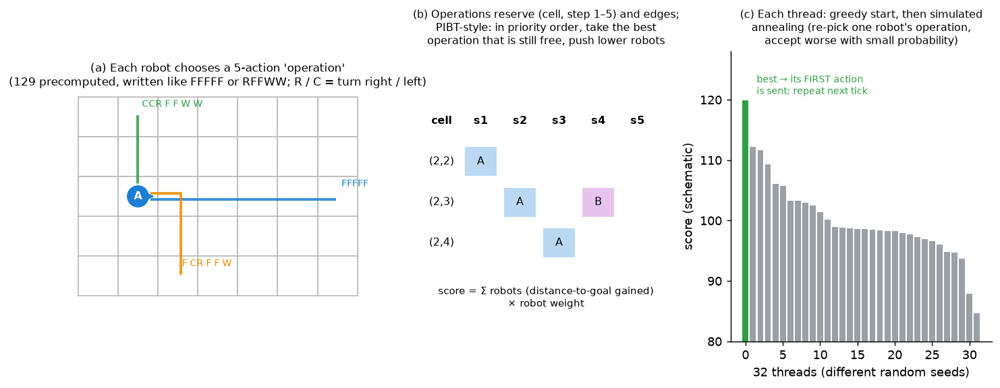

Code: [`eplanner.cpp#L36`](https://github.com/MAPF-Competition/Code-Archive/blob/main/2024%20Competition/Team_No_Man's_Sky/44950d1b61b7482b4529a9dc127fa9d220962bdc/Solution/Planner/eplanner.cpp#L36) (threads, best wins), [`PIBTS::solve`](https://github.com/MAPF-Competition/Code-Archive/blob/main/2024%20Competition/Team_No_Man's_Sky/44950d1b61b7482b4529a9dc127fa9d220962bdc/Solution/Planner/PIBT/pibts.cpp#L920) (greedy start + annealing), [`consider`](https://github.com/MAPF-Competition/Code-Archive/blob/main/2024%20Competition/Team_No_Man's_Sky/44950d1b61b7482b4529a9dc127fa9d220962bdc/Solution/Planner/PIBT/pibts.cpp#L12) (acceptance rule), [`DEPTH = 5`](https://github.com/MAPF-Competition/Code-Archive/blob/main/2024%20Competition/Team_No_Man's_Sky/44950d1b61b7482b4529a9dc127fa9d220962bdc/Solution/Objects/Environment/operations.hpp#L9), [the 129 operations](https://github.com/MAPF-Competition/Code-Archive/blob/main/2024%20Competition/Team_No_Man's_Sky/44950d1b61b7482b4529a9dc127fa9d220962bdc/Solution/Objects/Environment/operations.cpp#L50).

Two more details:

* With 32 threads it wants many cores; our benchmark pins each run to 2 (see the explainer).
* When there are more robots than tasks, it **parks** the surplus robots: they get no target and move only to make room ([`robot_handler.cpp#L91`](https://github.com/MAPF-Competition/Code-Archive/blob/main/2024%20Competition/Team_No_Man's_Sky/44950d1b61b7482b4529a9dc127fa9d220962bdc/Solution/Objects/Environment/robot_handler.cpp#L93)).

### 4.4 Kitty_Knight (2024, 2nd place): WPPL

**Intuition.** Plan properly, but only a short way ahead. Keep a collision-free plan for **every robot for the next 20 steps**, execute 1 step, slide the window, repeat. **WPPL** (Windowed Parallel PIBT-LNS) builds that window in two steps:

1. **Start**: get a window plan from LaCAM2 (§3.6).
2. **Improve**: run LNS (§3.5) with several threads in parallel. The destroy step picks 8 robots at random, along a random walk, or around a busy intersection, choosing among these adaptively. The repair step re-plans them with prioritized planning + SIPP (§3.4).

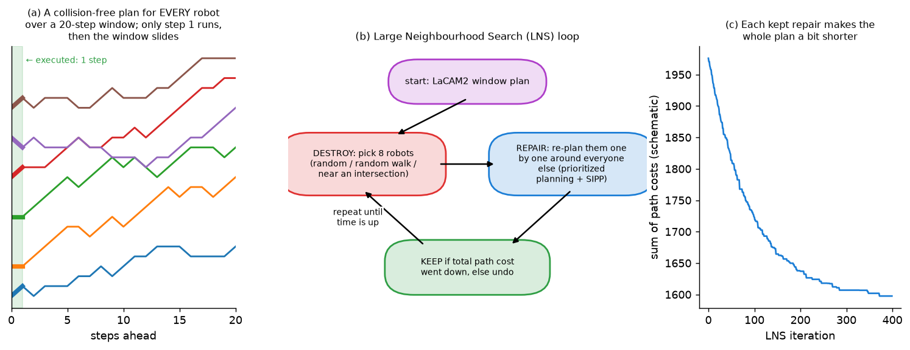

Code: [`LNSSolver::plan`](https://github.com/MAPF-Competition/Code-Archive/blob/main/2024%20Competition/Team_Kitty_Knight/da7d428b40cc1425b381adefe9709d4accbfdfe1/wppl_planner/src/LNS/LNSSolver.cpp#L95), destroy rules in [`NeighborGenerator.cpp#L166`](https://github.com/MAPF-Competition/Code-Archive/blob/main/2024%20Competition/Team_Kitty_Knight/da7d428b40cc1425b381adefe9709d4accbfdfe1/wppl_planner/src/LNS/Parallel/NeighborGenerator.cpp#L166), threads in [`GlobalManager.cpp#L30`](https://github.com/MAPF-Competition/Code-Archive/blob/main/2024%20Competition/Team_Kitty_Knight/da7d428b40cc1425b381adefe9709d4accbfdfe1/wppl_planner/src/LNS/Parallel/GlobalManager.cpp#L30). Settings for our map in [`random-32-32-20.json`](https://github.com/MAPF-Competition/Code-Archive/blob/main/2024%20Competition/Team_Kitty_Knight/da7d428b40cc1425b381adefe9709d4accbfdfe1/wppl_planner/configs/random-32-32-20.json): window 20 for ≤ 100 robots, `neighborSize` 8, `initAlgo` LaCAM2, `replanAlgo` PP, `sipp` true, `execution_window` 1. Reference: Jiang et al., SoCS 2024 (WPPL won the 2023 competition).

---

## 5. What they do in practice

From the full-log pool runs (100 robots, 1000 ticks, seed 0), here is how robots spend their ticks:

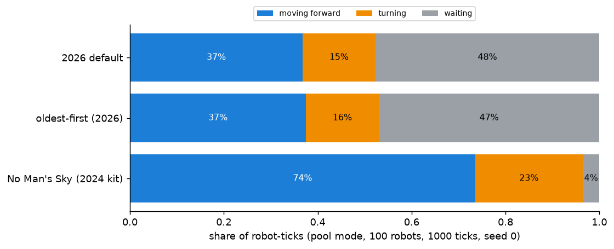

* **No Man's Sky** robots are almost never idle: 74% forward moves, 23% turns, 4% waits.
* The **2026-kit solvers** wait almost half the time. Changing the scheduler (default vs oldest-first) doesn't change this, so the waits come from the planner and kit, not the task order. Likely contributors:
  * the executor's STOPs (§4.1);
  * the forward moves `moveCheck` cancels behind turning robots (§3.2);
  * planning from a state predicted 10 ticks ahead.

  We haven't measured each one separately.
* The two kits differ in timing (see the explainer, §2.3), so compare planners **within** a kit.

---

## 6. Bringing in Kei18's planners

Keisuke Okumura's repositories ([github.com/Kei18](https://github.com/Kei18)) hold the reference implementations of PIBT ([pibt2](https://github.com/Kei18/pibt2)), LaCAM ([lacam](https://github.com/Kei18/lacam)) and LaCAM* ([lacam2](https://github.com/Kei18/lacam2), [lacam3](https://github.com/Kei18/lacam3)). They solve *one-shot* MAPF: no headings, fixed goals, and as much time as you like. To use them as LoRR planners, each needs four adaptations:

| Gap | What to do |
|---|---|
| Headings and turns | Plan in cells, then convert to actions as the default does (§3.2), or plan over (cell, heading) states |
| Goals change | Re-plan every call from the current state, and stop after a window of $k$ steps (as Kitty_Knight does with lacam2) |
| Time budget | Use the anytime behaviour: return the best plan found when time is up, falling back to plain PIBT |
| 2026 kit output | Return $k = 11$ steps per robot so the executor (§4.1) can stage them |

This is the planned next step: wire each one in behind `MAPFPlanner::plan`, benchmark it, and document the changes here.

---

## 7. Glossary and references

| Term | Meaning |
|---|---|
| MAPF / lifelong MAPF | multi-agent path finding; *lifelong*: robots get a new goal as soon as they reach one |
| configuration | where every robot is at one moment |
| vertex / swap conflict | two robots in one cell / passing through each other on one edge |
| heuristic $h$ | a cheap estimate of remaining distance, used to rank choices |
| PIBT | Priority Inheritance with Backtracking: greedy one-step joint move (§3.2) |
| guide path | a traffic-aware route that PIBT follows (§3.3) |
| A*, space-time A*, SIPP | single-robot shortest-path searches: in cells, in (cell, tick), in (cell, safe interval) |
| prioritized planning (PP) | plan robots one at a time, each avoiding the ones already planned |
| LNS | Large Neighbourhood Search: destroy part of a solution and repair it, keep if better |
| simulated annealing | local search that sometimes accepts a worse move, less often over time |
| LaCAM / LaCAM* | complete search over configurations using PIBT as the generator / its eventually optimal version |
| window | how many steps ahead a plan reaches; only the first step(s) are executed |
| executor, TPG | 2026 kit component that releases planned actions tick by tick; temporal plan graph = per-cell order of visits |
| CBS | Conflict-Based Search: optimal MAPF, too slow for 100 robots at LoRR speed |

References:
* Okumura et al., *Priority Inheritance with Backtracking for Iterative Multi-agent Path Finding*, Artificial Intelligence 2022 (IJCAI 2019).
* Okumura, *LaCAM: Search-Based Algorithm for Quick Multi-Agent Pathfinding*, AAAI 2023; *Improving LaCAM for Scalable Eventually Optimal Multi-Agent Pathfinding*, IJCAI 2023.
* Chen, Harabor, Li & Stuckey, *Traffic Flow Optimisation for Lifelong Multi-Agent Path Finding*, AAAI 2024.
* Phillips & Likhachev, *SIPP: Safe Interval Path Planning for Dynamic Environments*, ICRA 2011.
* Li et al., *Anytime Multi-Agent Path Finding via Large Neighborhood Search*, IJCAI 2021; *MAPF-LNS2*, AAAI 2022.
* Jiang et al., *Scaling Lifelong Multi-Agent Path Finding to More Realistic Settings: Research Challenges and Opportunities*, SoCS 2024 (WPPL).
* Ma, Kumar & Koenig, *Multi-Agent Path Finding with Delay Probabilities*, AAAI 2017.
* Sharon et al., *Conflict-Based Search for Optimal Multi-Agent Pathfinding*, Artificial Intelligence 2015.
