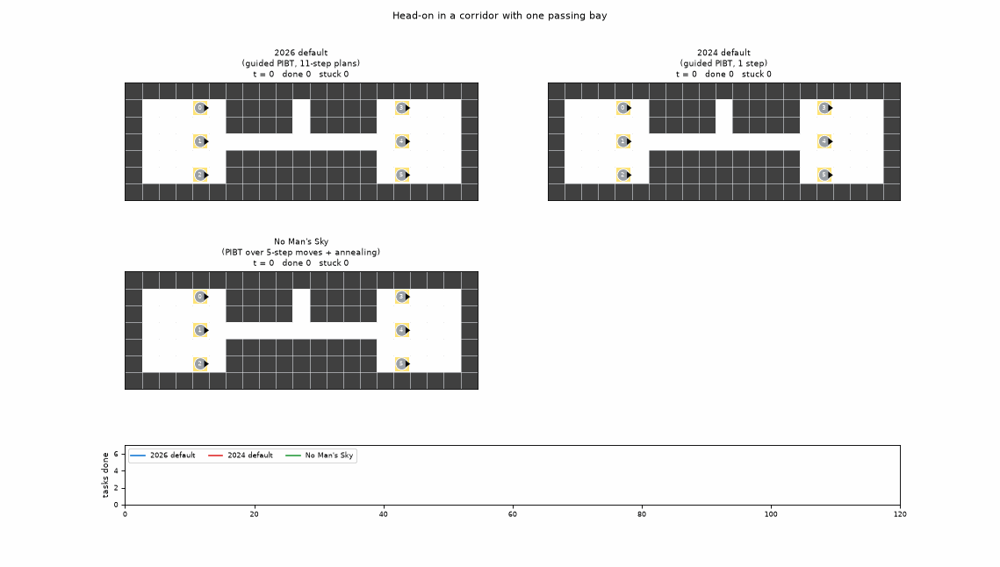
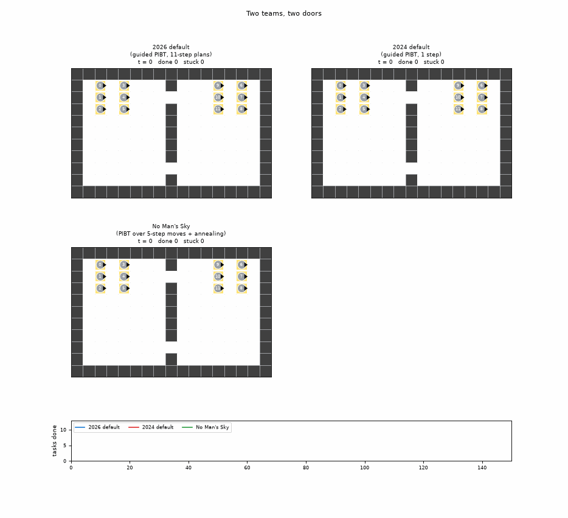
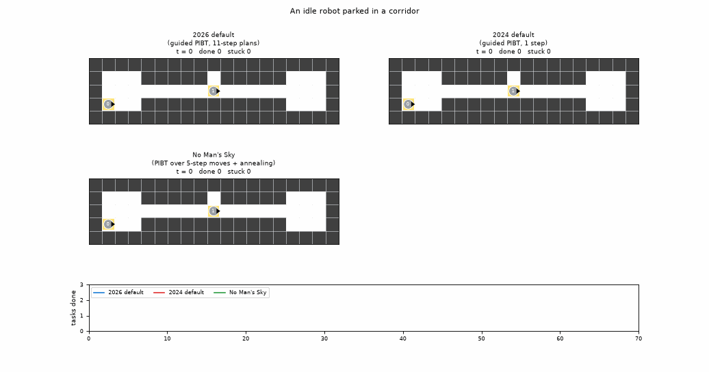
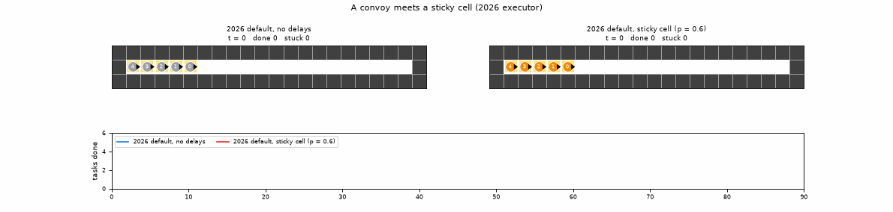
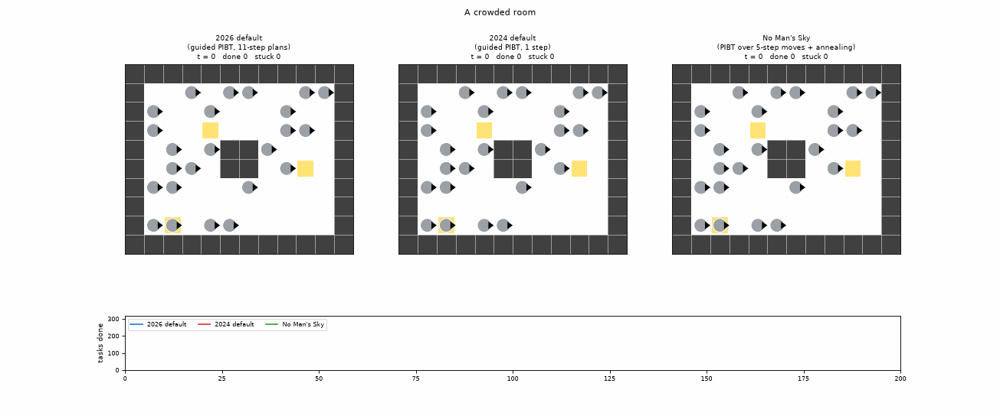
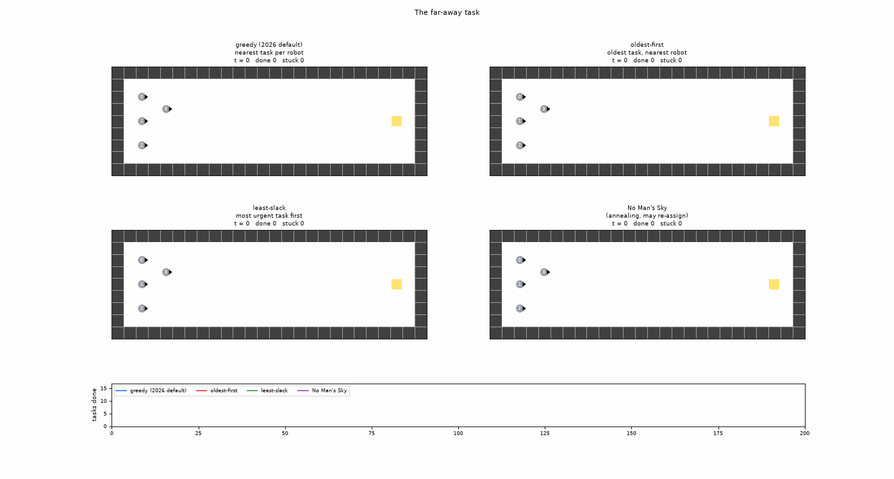
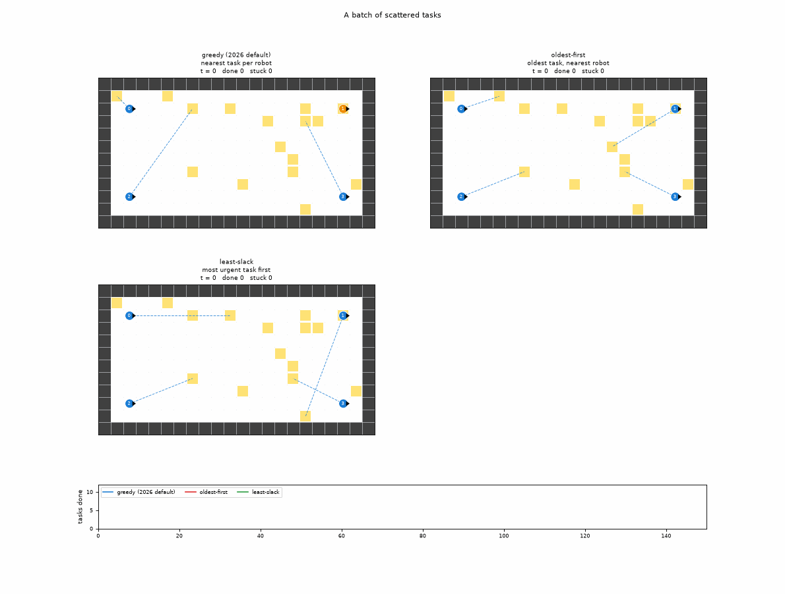
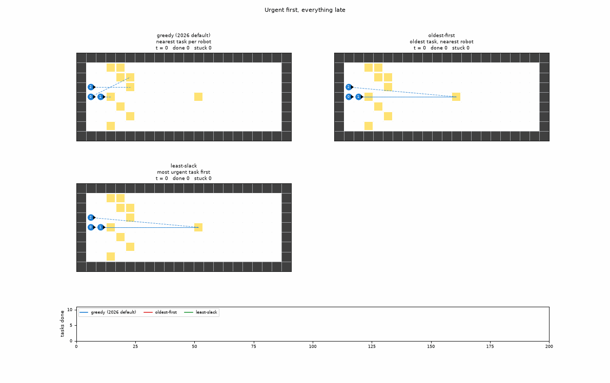
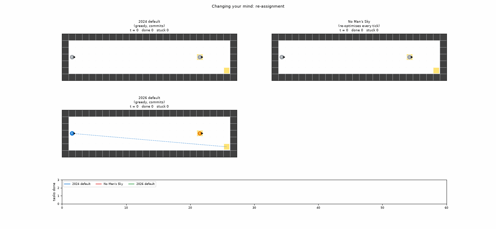
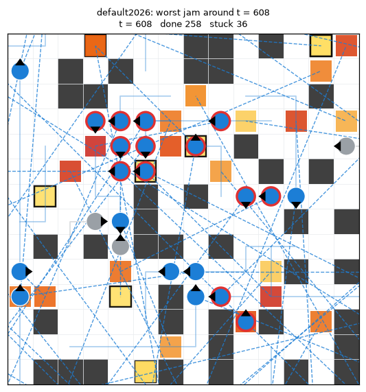

# Scenes: small situations that show how solvers differ

The benchmark says *how much* the solvers differ. The scenes show *why*. Each scene is a tiny hand-made map with a handful of robots and a script of tasks, built to bring out one behaviour. Every solver runs on it with the **real kit binaries**, so what you see is what the entry actually does, not a re-implementation.

```
python -m lorrext.scenes list
python -m lorrext.scenes run corridor_swap      # run + render one scene
python -m lorrext.scenes run --all               # every scene (parallel, pinned to cores)
python -m lorrext.scenes render --all            # re-render from cached runs
python -m lorrext.scenes hunt runs/explain/out/*.json   # worst local jam in a 100-robot run
```

Each scene produces `docs/scenes/<scene>.gif` (animation, one row per solver), `<scene>_snap.png` (rows = solvers, columns = key ticks) and `<scene>.json` (the metrics below). The code is in [`lorrext/scenes.py`](../lorrext/scenes.py).

**How to read the pictures.** Grey robot = idle, blue = going to a task, orange = working at an errand. A red ring = **stuck**: busy, but on the same cell for at least 4 ticks (turning in place counts as stuck). The dashed line runs from a robot to its next errand. Squares are open tasks, yellow turning red with age, with a black outline once they are past the deadline.

**Columns in the tables.**
- *Done*: tasks finished out of tasks revealed.
- *Latency*: mean time from reveal to finish of the finished tasks.
- *Late*: tasks that waited longer than the deadline, finished or not.
- *Stuck*: robot-ticks spent stuck.
- *Moving*: share of robot-ticks in which the robot changed cell.
- *Last done*: tick of the last finished task.

Tasks use the `"scripted"` arrival model (task *i* appears at tick `times[i]`; see `ext/lorr_ext.h`).

**Caveats.**
- The 2024 entries were written for the five competition maps. On a scene map No Man's Sky runs without its hand-drawn lane map, and its scheduler uses distance weight 1 instead of 5.
- Kitty_Knight is not in the scenes: it assumes tasks never run out, and on a finite scene it stalls and then crashes soon after its first task is finished. It appears in the [jam clips](#jams-in-the-100-robot-benchmark) instead.
- The 2026 kit runs in real time, so a scene's stuck counts can move a little between runs; finish times and task outcomes reproduce.

Contents
- Planner scenes: [corridor swap](#corridor-swap) · [two doors](#two-doors) · [idle blocker](#idle-blocker) · [delay convoy](#delay-convoy) · [crowded room](#crowded-room)
- Scheduler scenes: [far task](#far-task) · [scattered batch](#scattered-batch) · [slow station](#slow-station) · [re-assignment](#re-assignment)
- [Jams in the 100-robot benchmark](#jams-in-the-100-robot-benchmark)
- [What the scenes say](#what-the-scenes-say)

---

## Planner scenes

In the planner scenes every robot gets one task that starts on its own cell, so the scheduler has (almost) nothing to decide. No Man's Sky gives robot *i* task *i*. The two greedy defaults minimise total task cost and may swap tasks between robots, but both make the same swaps, so the 2024 and 2026 defaults move the same robots to the same places.

### Corridor swap

*Head-on in a corridor with one passing bay.* Three robots go right and three go left through a one-lane corridor. The only place to pass is a two-cell bay above the middle.



| Solver | Done | Latency | Late | Stuck | Moving | Last done |
|---|---|---|---|---|---|---|
| 2026 default (guided PIBT, 11-step plans) | 6/6 | 78.0 | 0 | 104 | 23% | 106 |
| 2024 default (guided PIBT, 1 step) | 6/6 | 38.5 | 0 | 1 | 33% | 48 |
| No Man's Sky (PIBT over 5-step moves + annealing) | 6/6 | 28.7 | 0 | 6 | 17% | 40 |

All three get through. No Man's Sky is fastest even though its robots move the *least* of the three. The 2026 default takes more than twice as long as the 2024 default, with the same guided PIBT idea, mostly because its robots wait for committed multi-step plans (see [What the scenes say](#what-the-scenes-say)).

### Two doors

*Two teams, two doors.* Six robots cross left to right and six right to left. Everyone's shortest path uses the top door; the bottom door is a long detour.



| Solver | Done | Latency | Late | Stuck | Moving | Last done |
|---|---|---|---|---|---|---|
| 2026 default (guided PIBT, 11-step plans) | 12/12 | 55.9 | 0 | 282 | 14% | 75 |
| 2024 default (guided PIBT, 1 step) | 12/12 | 34.4 | 0 | 6 | 26% | 53 |
| No Man's Sky (PIBT over 5-step moves + annealing) | 10/12 | 25.6 | 0 | 10 | 21% | 37 |

No Man's Sky finishes ten tasks by tick 37, faster than anyone, and then **never finishes the last two**. Its robots with no task are "disabled": they stand still (the source comment, in Russian, says "stand still and don't bother anyone") and carry zero weight in its optimiser, so nothing ever pushes them aside. Two finished robots happen to park on the goal cells of two others, which then circle next to their goals for 110 ticks. In the competition tasks never run out, no robot is ever idle, and this never shows. It's the same kind of finite-workload failure as Kitty_Knight's.

### Idle blocker

*An idle robot parked in a corridor.* Robot 1 finishes its task on the spot at tick 1 and is then idle in the middle of a one-lane corridor. Robot 0 needs to get through. There is a one-cell pocket right above robot 1.



| Solver | Done | Latency | Late | Stuck | Moving | Last done |
|---|---|---|---|---|---|---|
| 2026 default (guided PIBT, 11-step plans) | 2/2 | 20.5 | 0 | 17 | 19% | 40 |
| 2024 default (guided PIBT, 1 step) | 2/2 | 11.0 | 0 | 0 | 37% | 21 |
| No Man's Sky (PIBT over 5-step moves + annealing) | 2/2 | 12.5 | 0 | 1 | 13% | 22 |

Everyone gets through, in two different ways. No Man's Sky steps the idle robot into the pocket and back out (it only ever visits two cells). Both defaults instead push the idle robot ahead of robot 0 down the whole corridor, until it ends up at the far end next to robot 0's goal. PIBT's push moves a blocking robot one step further along, not aside. Compare with *two doors*, where No Man's Sky's idle robots sit on other robots' goals and nothing moves them.

### Delay convoy

*A convoy meets a sticky cell (2026 executor).* Five robots drive in a line along a one-lane corridor. On the second run one cell makes a robot stall for 4–6 ticks on 60% of its visits (`"trigger": "enter"`, one roll per visit). The planner doesn't know about the delay. The executor keeps the planned order, so everyone behind the stalled robot gets STOP and waits, without collisions.



| Run | Done | Latency | Late | Stuck | Moving | Last done |
|---|---|---|---|---|---|---|
| 2026 default, no delays | 5/5 | 45.0 | 0 | 123 | 17% | 49 |
| 2026 default, sticky cell (p = 0.6) | 5/5 | 58.4 | 0 | 154 | 17% | 76 |

Four of the five robots are delayed once each, at ticks 24, 32, 51 and 59. Each delay holds up everyone behind, so the convoy finishes 27 ticks later even though it lost at most 6 ticks per robot.

> **Delay trigger.** The default delay rule (`"trigger": "tick"`) rolls every tick a robot is on the cell and not already delayed, as the kit's own delay model does. On the tick a delay ends the robot is still on the cell, so it rolls again before it can leave. At small per-tick `p` that hardly matters; at p = 0.6 it chains delays back to back (an earlier version of this scene had one robot delayed four times in a row). Use `"enter"` for "this cell is slow to cross".

### Crowded room

*A crowded room.* 24 robots in a 10 × 12 room with a pillar, 2 new tasks per tick on average for 200 ticks. No clever assignment is possible; the planner decides how much of the time robots move, turn or wait.



| Solver | Done | Latency | Late | Stuck | Moving | Last done |
|---|---|---|---|---|---|---|
| 2026 default (guided PIBT, 11-step plans) | 86/400 | 64.3 | 0 | 2101 | 12% | 199 |
| 2024 default (guided PIBT, 1 step) | 270/400 | 26.2 | 0 | 76 | 52% | 197 |
| No Man's Sky (PIBT over 5-step moves + annealing) | 318/400 | 22.7 | 0 | 48 | 62% | 200 |

The 2026 default finishes a third as many tasks as the 2024 default, and its robots move 12% of the time against 52%. The benchmark shows the same direction at a smaller ratio (pool throughput 0.44 vs 0.81 tasks/tick); a packed room exaggerates it. No Man's Sky's 132 re-assigned tasks are its scheduler at work: in a crowd it keeps handing tasks to whichever robot is closer.

---

## Scheduler scenes

The scheduler scenes compare the three 2026-kit schedulers on the same planner (the 2026 default): greedy (each free robot takes its shortest task), oldest-first (oldest task, nearest robot) and least-slack (most urgent task first). No Man's Sky is added where re-assignment matters.

### Far task

*The far-away task.* One task appears at the far end at t = 0; short tasks keep appearing right next to the four robots, faster than they can serve them.



| Solver | Done | Latency | Late | Stuck | Moving | Last done |
|---|---|---|---|---|---|---|
| greedy (2026 default) | 16/101 | 63.4 | 0 | 331 | 14% | 184 |
| oldest-first | 15/101 | 97.8 | 0 | 273 | 23% | 188 |
| least-slack | 16/101 | 97.9 | 0 | 292 | 23% | 198 |
| No Man's Sky (annealing, may re-assign) | 16/101 | 14.8 | 0 | 2 | 67% | 80 |

All three 2026 schedulers finish the far task at about tick 45: at t = 0 it is the only task, and once assigned they never take it back.

**No Man's Sky never finishes it, and from tick 80 it finishes nothing at all.** Up to then it is far ahead of the others (16 tasks, low latency). Then it **livelocks**: from tick 84 the four robots repeat the same 12-tick loop until the run ends. Each robot circles its next errand cell at distance one and never steps onto it, even though the cell is free. Three reruns give the same loop at the same tick. On the benchmark map No Man's Sky is the strongest entry, so this probably comes from running it on a map it wasn't tuned for (no hand-drawn lane map, see the caveats), but the cause is not pinned down. Its mean latency of 14.8 looks excellent only because latency counts finished tasks; the max wait of 200 ticks gives it away.

### Scattered batch

*A batch of scattered tasks.* 16 tasks appear at once all over the map, in random order. Oldest-first serves them in that order, so robots criss-cross the map; greedy takes whatever is nearest.



| Solver | Done | Latency | Late | Stuck | Moving | Last done |
|---|---|---|---|---|---|---|
| greedy (2026 default) | 11/16 | 84.7 | 0 | 216 | 30% | 148 |
| oldest-first | 9/16 | 77.4 | 0 | 183 | 38% | 150 |
| least-slack | 10/16 | 83.6 | 0 | 152 | 42% | 143 |

Greedy finishes the most. Oldest-first's robots move more and finish fewer: the extra movement is the criss-crossing. Least-slack lands in between.

### Slow station

*Urgent first, everything late.* Four tasks end at one of two slow stations (40 ticks of work each); nine quick tasks sit next to the three robots. Deadline D = 90 ticks, and three robots cannot finish everything in time.



| Solver | Done | Latency | Late | Stuck | Moving | Last done |
|---|---|---|---|---|---|---|
| greedy (2026 default) | 10/13 | 78.9 | 7 | 296 | 18% | 190 |
| oldest-first | 7/13 | 139.9 | 12 | 308 | 24% | 195 |
| least-slack | 7/13 | 138.0 | 12 | 301 | 24% | 189 |

Least-slack knows the stations are slow and sends robots there first. The four slow jobs queue at the two stations (finished at ticks 69, 99, 122 and 161), and **every quick task then misses the deadline**. Greedy does the quick tasks first and gives up on the slow ones, finishing only one: 7 late tasks instead of 12. This is the classic weakness of urgent-first rules under overload: when not everything can be on time, serving the most urgent task first spreads lateness instead of containing it. Oldest-first matches least-slack here only because all tasks arrive at once and ties go to the lowest id, which happens to be the slow tasks.

### Re-assignment

*Changing your mind.* Robot 1 is busy right next to a new task; robot 0 is free but far away. A committing scheduler sends robot 0 on the long trip. One that may re-assign unopened tasks can hand the task to robot 1 as soon as it is free.



| Solver | Done | Latency | Late | Stuck | Moving | Last done |
|---|---|---|---|---|---|---|
| 2024 default (greedy, commits) | 2/2 | 21.0 | 0 | 0 | 51% | 32 |
| No Man's Sky (re-optimises every tick) | 2/2 | 17.0 | 0 | 1 | 19% | 22 |
| 2026 default (greedy, commits) | 2/2 | 45.5 | 0 | 45 | 29% | 46 |

No Man's Sky moves the task to robot 1 (one re-assignment) and finishes 10 ticks earlier while its robots move far less. Both committing defaults make robot 0 drive across.

---

## Jams in the 100-robot benchmark

`hunt` looks through a full benchmark run (random-32-32-20, 100 robots, 1.5 tasks/tick pool, 1000 ticks) for the densest jam: the most stuck robots within one 8 × 8 area, summed over 10 ticks and skipping the first 50 ticks of start-up. It then renders a zoomed clip around it.

| Run | Worst jam | Clip |
|---|---|---|
| 2026 default | 12 stuck robots at t = 608 | [gif](scenes/hunt_default2026.gif) · [frame](scenes/hunt_default2026.png) |
| oldest-first (2026) | 13 stuck robots at t = 117 | [gif](scenes/hunt_fifo2026.gif) · [frame](scenes/hunt_fifo2026.png) |
| 2024 default | 2 at t = 69 | [gif](scenes/hunt_default2024.gif) |
| No Man's Sky | 2 at t = 94 | [gif](scenes/hunt_nms2024.gif) |
| Kitty_Knight | 1 at t = 634 | [gif](scenes/hunt_kitty2024.gif) |



The 2024 entries do not really jam at this load: their worst moment is one or two robots. The 2026 kit is different in kind. About 55 of its 100 robots are stuck at any moment of the run (2–4 for every 2024 entry), and 92% of that stuck time is waiting, not turning, often in streaks of 10–39 ticks, with no planner errors or timeouts.

---

## What the scenes say

1. **The 2026 default is slow in every planner scene**, including ones with two robots (*idle blocker*: 40 vs 21 ticks). Congestion can't explain that alone. Its robots wait a lot, in long streaks, even when nothing is in their way. Whether that is the planner's committed 11-step plans or our real-time settings (30 ms ticks, 300 ms planner window, see `lorrext/core.py`) starving it is **open**, and it matters for every 2026-kit number in the benchmark.
2. **The 2024 entries are brittle outside the conditions they were built for.** Kitty_Knight crashes when tasks run out. No Man's Sky's idle robots never yield a goal cell (*two doors*), and on the *far task* map it livelocks from tick 84 on. None of this shows on the benchmark map at moderate load.
3. **Re-assignment pays when robots are close to each other's tasks** (*re-assignment*, *crowded room*). Mean latency only counts finished tasks, so a solver that stops finishing can look best (*far task*): look at max wait too.
4. **Urgency-first scheduling backfires under overload** (*slow station*): with more work than time, least-slack makes more tasks late than greedy.
